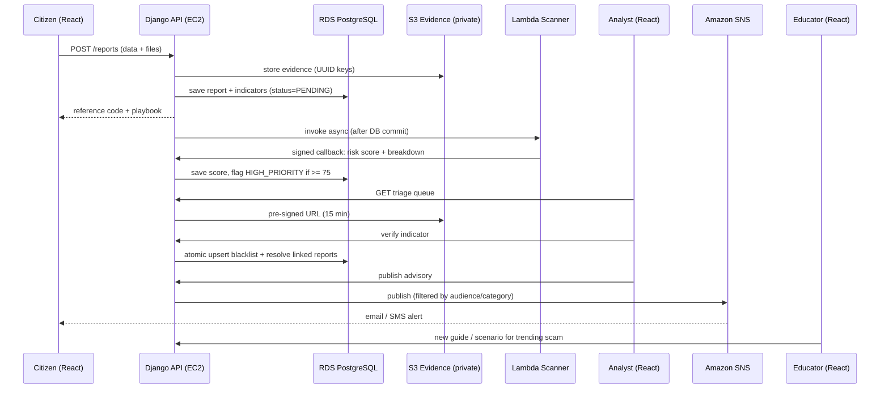

# ScamShield Cloud — Project Overview

| | |
|---|---|
| Module | CT071-3-3-DDAC — Designing & Developing Cloud Applications |
| Problem chosen | Problem Background #1 — Online scams |
| Team | 4 students (4 roles, 8 unique functionalities) |
| Status | DRAFT — topic must be approved by lecturer before work starts (Rule 3) |
| Related docs | `02-project-architecture.md`, `03-backend-build-plan.md`, `03a-database-design.md` |

---

## 1. Summary

ScamShield Cloud is a web platform where citizens can **report scams (anonymously if they want)**, **check whether a phone number / link / email / bank account is a known scam before they trust it**, and **learn to spot scams through a simulator**. Cyber-threat analysts turn scattered reports into a verified blacklist and broadcast warnings during scam waves. A cloud admin controls access, tunes the automated risk scanner, and watches system health. It runs on AWS with a highly available design.

## 2. Problem → Solution mapping

| Problem (from brief) | System answer |
|---|---|
| Scams use manipulation, urgency, fake identities | Heuristic scanner flags urgency/coercion patterns; simulator trains users to recognise them |
| Victims under-report (embarrassment, fear, no guidance) | Anonymous-optional report form + instant recovery playbook |
| Scams span email/social/messaging; no central view | One report schema across platforms; indicator clustering; trend dashboard |
| No verified, real-time info for the public | Public lookup with Red/Yellow/Green verdict; SNS alert subscriptions |
| Digital-literacy gap (elderly, teens, non-tech users) | Group-targeted guides (large-font/high-contrast/audio) + "Spot the Scam" simulator |
| Law enforcement can't keep up | Triage workbench, dedup by indicator, threat levels, emergency advisories |

## 3. Objectives and success criteria

| # | Objective | Measurable target (proposed — confirm with team) |
|---|---|---|
| O1 | Fast, safe lookup | p95 lookup API < 300 ms at 100 concurrent users |
| O2 | Easy reporting | Report submission (without upload time) p95 < 1.5 s; ≤ 2 minutes to complete form |
| O3 | High availability | App tier on ≥ 2 AZs behind a load balancer; DB Multi-AZ; target 99.9% |
| O4 | Scalability | Auto Scaling on CPU target 60%; load test 100 concurrent users, 10 min, < 1% errors |
| O5 | Data safety | Evidence private by default; RPO ≤ 5 min (DB point-in-time recovery); RTO ≤ 30 min |
| O6 | Observability | CloudWatch dashboard + alarms for CPU, DB connections, 5xx rate, latency, business metrics |
| O7 | Cost-effective | Documented service choices with cost reasoning; billing alarm set |

## 4. Scope

**In scope:** 4 roles, 8 functionalities (Section 6), React SPA, Django REST API, PostgreSQL on RDS, S3, SNS, Lambda, CloudFront, CloudWatch, ALB + Auto Scaling, containerised deployment.
**Out of scope (state this in the report):** payment recovery/legal action, integration with real police systems, mobile app, ML models (scanner is rule-based), automatic takedown of scam sites, virus scanning of uploads (mitigated by type allow-list + content checks).

## 5. Users and roles

| Role | Student | Who | Account | Core permissions |
|---|---|---|---|---|
| Public Citizen / Victim | S1 | Anyone | Optional (anonymous allowed) | Submit reports, track own reports, lookup, subscribe, read guides, play simulator |
| Cyber Threat Analyst | S2 | Authority staff | Required + admin approval | Triage queue, view evidence, verify/reject/revoke indicators, analytics, broadcast advisories |
| Digital Literacy Educator | S3 | Educator/NGO staff | Required + admin approval | Manage guides, assets, simulator scenarios |
| Cloud & Security Admin | S4 | System owner | Required (seeded) | Approve staff, scanner rules, telemetry, audit log |

## 6. Feature catalogue (8 unique functionalities)

| ID | Owner | Feature | AWS services |
|---|---|---|---|
| F1.1 | S1 | Anonymous/trackable scam reporting + evidence vault | EC2, RDS, S3 |
| F1.2 | S1 | Real-time IoC lookup + regional alert subscription | EC2, RDS, SNS |
| F2.1 | S2 | Evidence triage, dedup & IoC blacklist workbench | EC2, RDS, S3 (pre-signed URLs) |
| F2.2 | S2 | Trend analytics + emergency threat broadcast | EC2, RDS, SNS |
| F3.1 | S3 | Vulnerable-group multimedia resource CMS | EC2, RDS, S3, CloudFront |
| F3.2 | S3 | "Spot the Scam" phishing simulator | EC2, RDS, S3, CloudFront |
| F4.1 | S4 | Heuristic scam scanner (Lambda) + staff RBAC | EC2, RDS, Lambda |
| F4.2 | S4 | CloudWatch telemetry + abuse audit portal | EC2, RDS, CloudWatch |

Shared infrastructure (VPC, ALB, ASG, RDS, ECR, CI/CD, base login) has an explicit owner in the workload matrix (Section 12).

## 7. User journeys

### 7.1 Citizen — report a scam (F1.1)
1. Home → **Report a Scam** → choose *Logged-in tracking* or *Anonymous*.
2. Pick category (Phishing, Fake Job, E-commerce Fraud, Impersonation, Other) and platform (WhatsApp, Telegram, Facebook, Email, SMS, Website, Other).
3. Enter scammer identifiers (phone, URL, email, bank account — at least one, max 5), paste message text, optional loss amount + currency + payment method, attach up to 3 screenshots/PDFs.
4. Submit → receive **reference code** (e.g. `SCM-2026-K7Q4M2X9`); anonymous users also receive a **one-time access key** to check status later.
5. Confirmation page shows the **Recovery Playbook** for their incident (e.g. bank-transfer loss → immediate bank-freeze steps + national hotlines).
6. Alternate paths: validation error (field-level messages), file too large/wrong type, rate limit reached (clear message + retry time), duplicate submit (idempotent — same reference returned).

### 7.2 Citizen — lookup & subscribe (F1.2)
1. Paste a number/URL/email/account into the lookup bar on the home page.
2. Verdict card: **Red** (verified scam: report count, category, first/last seen, curated warning note) · **Yellow** (unverified reports/heuristic flag, awaiting analyst) · **Green** (no reports — caution banner: scammers rotate identifiers).
3. Optional: subscribe by email or SMS, choose audience (e.g. Senior-family alerts) and scam categories; confirm via the confirmation message; unsubscribe link in every alert.

### 7.3 Analyst — triage (F2.1)
1. Log in → queue sorted by **risk score** (high first) and **cluster size**.
2. Open a report → split view: left narrative + extracted indicators, right evidence (private S3 via 15-min pre-signed URL).
3. **Verify & Blacklist** (pick which indicator(s)) → indicator promoted to public blacklist; all linked pending reports auto-resolved as Verified; threat level escalated. Or **Reject** (false positive/spam) with reason. Later **Revoke** a wrong blacklist entry.

### 7.4 Analyst — trends & broadcast (F2.2)
1. Dashboard: volume by platform/category over time, losses by region, top manipulation tactics, spike detector (e.g. +300% in 24 h).
2. **Draft Public Threat Advisory** → title, summary, severity, target audience → **Broadcast** → SNS fans out email/SMS to matching subscribers; advisory appears on public advisories page.

### 7.5 Educator — guides & simulator (F3.1, F3.2)
1. Create guide: text/markdown body, target groups (Elderly, Teens, Non-tech, General), language (en/ne/ms), readability mode, tactic tags, attach PDF/audio/image → publish.
2. Build scenario: upload mock screenshot, mark scam/legit, tag tactic (Urgency/Authority/Fear/Greed/None), draw red-flag hotspots with explanations → publish.
3. Citizens browse the Learning Hub filtered by group (elderly view auto-enables large font/high contrast/text-to-speech) and play a 5-scenario challenge → Digital Literacy Score, blind-spot profile, recommended guides.

### 7.6 Admin — access, rules, telemetry (F4.1, F4.2)
1. Review pending analyst/educator registrations (organisation + credentials) → approve/reject.
2. Manage heuristic rules (keywords + weights, suspicious TLDs, shorteners) and thresholds; changes are versioned.
3. Telemetry dashboard (CloudWatch EC2/RDS metrics + custom business metrics) and audit log (rate-limit blocks, role changes, evidence access, rule changes).

## 8. End-to-end data flow

## 9. Functional requirements

| ID | Requirement |
|---|---|
| FR-1.1.1 | Anonymous report needs no account; anonymous reports store no user link and no raw IP |
| FR-1.1.2 | Report requires category, platform, ≥ 1 and ≤ 5 indicators; message ≤ 5000 chars; loss ≥ 0 |
| FR-1.1.3 | ≤ 3 evidence files; PNG/JPEG/PDF only (checked by file content, not just extension); ≤ 5 MB each; stored under random UUID keys |
| FR-1.1.4 | Unique non-guessable reference code; anonymous status check needs reference + access key |
| FR-1.1.5 | Recovery playbook chosen by category, payment method, region |
| FR-1.1.6 | Saving a report triggers scan asynchronously; scan failure never fails the submission |
| FR-1.1.7 | Max 5 anonymous reports per IP per hour; blocked attempts are audit-logged |
| FR-1.2.1 | Lookup accepts phone/URL/domain/email/bank account; input normalised before search |
| FR-1.2.2 | Red/Yellow/Green verdict; public response never includes victim text, raw evidence, or PII |
| FR-1.2.3 | Subscription by email/SMS with audience + category filters; confirmation required; one-click unsubscribe |
| FR-2.1.1 | Queue sortable by risk score and cluster size; filter by status/platform/category |
| FR-2.1.2 | Evidence only via 15-minute pre-signed URLs, analyst role only, each issue audit-logged |
| FR-2.1.3 | Verify = one atomic transaction: upsert indicator, increment count, resolve linked reports, escalate threat level (1–2 MEDIUM, 3–9 HIGH, 10+ CRITICAL) |
| FR-2.1.4 | Reject requires reason; revoke of blacklist entry requires reason; both audit-logged |
| FR-2.2.1 | Aggregations by platform, category, date, region; losses summed; top tactics |
| FR-2.2.2 | Spike detection: last 24 h vs trailing 7-day average per category/platform |
| FR-2.2.3 | Advisory lifecycle DRAFT → PUBLISHED/FAILED; broadcast does not block the request thread beyond one SNS publish call |
| FR-3.1.1 | Guide CRUD with groups, language, readability mode, tactic tags, assets (PDF/audio/image) |
| FR-3.1.2 | Public hub filters by group/language; elderly mode enables ≥ 20 px base font, high contrast, text-to-speech |
| FR-3.1.3 | Media delivered via CloudFront; bucket stays private (Origin Access Control) |
| FR-3.2.1 | Scenario CRUD: screenshot, scam/legit flag, tactic, red-flag hotspots (percentage coordinates) |
| FR-3.2.2 | Attempt = 5 random published scenarios; correct answers never sent to the client before answering |
| FR-3.2.3 | Score + per-tactic profile; ≥ 2 misses on a tactic → recommend guides tagged with that tactic |
| FR-4.1.1 | Admin approves/rejects staff accounts; role changes audit-logged |
| FR-4.1.2 | Rule matrix editable; changes bump a ruleset version stored with each scan |
| FR-4.1.3 | Score = min(100, keywords(+15 each, cap 45) + TLD/IP(+25) + shortener(+15) + prior pending(+20)); ≥ 75 → HIGH_PRIORITY + staff alert |
| FR-4.2.1 | Dashboard shows CloudWatch EC2/RDS metrics (last 24 h) and custom metrics (reports/hour, alerts/hour) |
| FR-4.2.2 | Audit log viewer with filters; IP-based throttling logged |

## 10. Non-functional requirements

| Area | Requirement |
|---|---|
| Performance | Targets in Section 3; indexed lookups; no N+1 queries (tested) |
| Availability | ≥ 2 AZs for app and DB; health-checked; rolling deploys with zero downtime |
| Security | HTTPS everywhere; deny-by-default API; role-based access; OWASP Top 10 reviewed; secrets never in code/images; least-privilege IAM |
| Privacy | Evidence private; anonymous mode truly unlinkable; PII minimised and masked in logs; retention limits (see DB design) |
| Reliability | External AWS calls have timeouts; failures degrade gracefully and are retried by a job |
| Maintainability | Layered code (views → services → models), tests on all business rules, OpenAPI spec as the front/back contract |
| Accessibility | WCAG 2.1 AA target; elderly mode; keyboard navigable; alt text on educational images |
| Localisation | Phone normalisation for Malaysia (+60) and Nepal (+977); content language field (en/ne/ms) |
| Cost | Right-sized instances; lifecycle rules; log retention; documented idle-shutdown for dev resources |

## 11. Software requirements

**Developer machine:** Git, Docker Desktop (Compose v2), Python 3.12, Node.js 20/22 LTS, AWS CLI v2, VS Code or equivalent, Postman/Bruno, k6 or Locust (load test).
**Backend:** Django 5.2 LTS, Django REST Framework, SimpleJWT (+ token blacklist), psycopg 3, django-storages/boto3, drf-spectacular, django-filter, gunicorn, phonenumbers, tldextract, argon2-cffi, python-magic (or Pillow for images), pytest-django, moto, factory_boy.
**Frontend:** React 18/19 + Vite + TypeScript, React Router, TanStack Query, Axios, Chart.js (react-chartjs-2), Tailwind CSS.
**AWS:** VPC, EC2 + Auto Scaling, ALB, RDS PostgreSQL 16 (Multi-AZ), S3, CloudFront, SNS, Lambda, CloudWatch (Metrics, Logs, Alarms, Dashboards), IAM, SSM Parameter Store, ECR, (optional) ACM/Route 53, AWS Budgets.
**Accounts:** AWS account (check if using AWS Academy Learner Lab — session limits and restricted IAM may change some choices), GitHub.

## 12. Workload matrix (Rule 9)

| Area | S1 | S2 | S3 | S4 |
|---|---|---|---|---|
| Role | Citizen | Analyst | Educator | Admin |
| Functionalities | F1.1, F1.2 | F2.1, F2.2 | F3.1, F3.2 | F4.1, F4.2 |
| Django apps | `reports`, `alerts` | `intel`, `broadcasts` | `literacy` | `accounts` (RBAC), `scanner`, `ops` |
| React pages | Report, Track, Lookup, Subscribe | Triage, Investigation, Trends, Advisories | Studio, Hub, Simulator | Users, Rules, Telemetry, Audit |
| AWS | S3 evidence bucket, SNS subscribe | S3 pre-signed, SNS publish | S3 media, CloudFront | Lambda, CloudWatch, Auto Scaling |
| Shared infra owner | | | | **S4**: VPC, ALB, ASG, RDS, ECR, CI/CD |
| Shared base | S1: citizen register/login UI | S2: API conventions/error envelope | S3: layout/accessibility base | S4: auth backend, `core` utilities |
| Report/docs | Sections for own features + testing evidence | same | same | same + architecture/performance section |

Cross-student contracts (frozen in Phase 1 of the backend plan): model/enum names, service function signatures, SNS topic ownership, audit/metric helper signatures.

## 13. Assumptions, constraints, risks

| Risk | Mitigation |
|---|---|
| Lecturer rejects/changes scope | Get approval first; plan is modular (features can be trimmed) |
| AWS Academy/Learner Lab limits (IAM, SES, session expiry) | Check limits in week 1; keep IaC/runbook to rebuild quickly; email-first alerts |
| SNS SMS availability/cost for MY/NP | Email is primary; SMS optional behind a feature flag |
| Cost overrun (NAT, ALB, Multi-AZ RDS) | AWS Budgets alarm; stop/scale down dev resources; documented cost levers |
| Team dependencies (S1 needs S2 models, S3 needs guides) | Contracts frozen early; stub services; parallel plan in backend file |
| Evidence contains victim PII | Private bucket, pre-signed access, audit log, retention policy |
| Plagiarism | Cite sources; paraphrase; acknowledge AI assistance per university rules |
| Marking scheme not yet seen | Obtain from Moodle and map criteria to deliverables |

## 14. Brief compliance checklist

| Brief requirement | Where satisfied |
|---|---|
| One problem addressed | Problem #1 — Sections 1–2 |
| Cloud compute + DB + storage | EC2 ASG, RDS, S3 |
| High performance & availability | ALB, ASG, Multi-AZ RDS, CloudFront, indexes, load test |
| Deployed on AWS | `02` Section 14 |
| AWS monitoring tools | CloudWatch dashboard, alarms, logs, custom metrics (F4.2) |
| 3–4 students, distinct roles, ≥ 2 unique functions each | Sections 5, 6, 12 |
| Workload matrix | Section 12 |
| Task 1 (30): frontend + backend + compute + DB | React, Django, EC2, RDS |
| Task 2 (20): other services + monitoring | S3, CloudFront, SNS, Lambda, CloudWatch |
| CLO2: design with performance criteria | Section 3 + architecture doc |
| CLO3: HA, cost-effective service selection | `02` Sections 3, 10, 17 |
