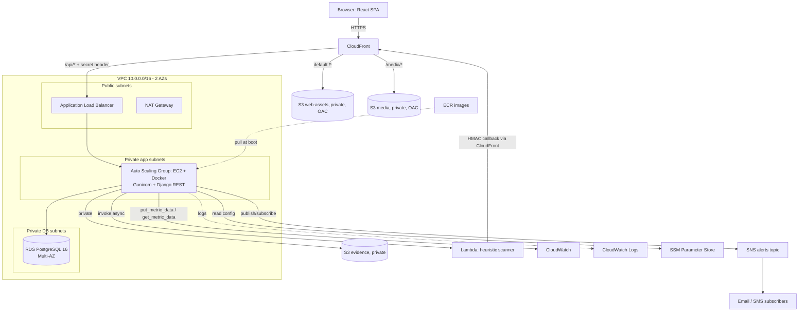
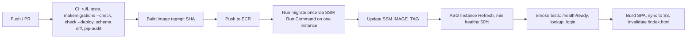

# ScamShield Cloud — Project Architecture & Production Rulebook

Related: `01-project-overview.md` · `03-backend-build-plan.md` · `03a-database-design.md`

---

## 1. Architecture principles

1. **Stateless app tier.** Any EC2 instance can die at any time; nothing important lives on local disk or in process memory (no local cache for rate limits, no local file storage).
2. **One source of truth per concern.** PostgreSQL = data; S3 = files; SNS = fan-out; CloudWatch = telemetry; SSM = config/secrets.
3. **Thin views, fat services.** HTTP in views; rules in `services/`; reads in `selectors/`.
4. **Deny by default.** Every endpoint requires auth unless explicitly marked public.
5. **Never let an optional integration break a core action.** Reports save even if Lambda, SNS, or CloudWatch are down.
6. **Everything reproducible.** Image tagged by git SHA, config in env/SSM, infra written down (IaC or runbook).

## 2. System architecture



**Request paths**
- `app.example/` → CloudFront → S3 (React build). SPA fallback: 403/404 → `/index.html`.
- `app.example/api/*` → CloudFront (no caching) → ALB → EC2. **Same origin as the SPA, so no CORS in production** and the refresh cookie works.
- `app.example/media/*` → CloudFront → S3 media bucket (guides, simulator images).
- Evidence never goes through CloudFront; only analysts get 15-minute pre-signed URLs.

## 3. Technology stack and justification

| Layer | Choice | Why (CLO3 reasoning) |
|---|---|---|
| Frontend | React + Vite + TypeScript, React Router, TanStack Query, Axios, Chart.js, Tailwind | Fast builds; typed API; server-state caching |
| Frontend hosting | S3 + CloudFront | Cheapest HA static hosting; global edge; no server to patch |
| API | Django 5.2 LTS + DRF | Mature ORM, auth, validation; matches team skills |
| Auth | SimpleJWT (+ blacklist), Argon2 | Stateless access tokens; revocable refresh |
| DB | PostgreSQL 16 on RDS Multi-AZ | ACID for verify transaction; arrays/JSONB; managed failover/backups |
| Compute | EC2 (t3 family) in Auto Scaling Group, Docker containers | Required by brief; ASG gives HA + elasticity |
| Load balancing | Application Load Balancer | Health checks, multi-AZ, path routing |
| Files | S3 (evidence private; media private behind CloudFront OAC) | Durable, cheap, offloads EC2 |
| Async | Lambda (scanner), SNS (fan-out) | Pay per use; decoupled |
| Monitoring | CloudWatch Metrics/Logs/Alarms/Dashboards | Required by brief |
| Config | SSM Parameter Store (SecureString) | Free tier friendly; cheaper than Secrets Manager |
| CI/CD | GitHub Actions → ECR → ASG instance refresh | Simple, reproducible |
| Tests | pytest-django, moto, factory_boy; Vitest for frontend; k6/Locust for load | |

## 4. Frontend ↔ Backend contract

| Topic | Decision |
|---|---|
| Base URL | `/api/v1/` (version in path; breaking change → `/v2/`) |
| Dev setup | Vite dev server proxies `/api` → `http://localhost:8000` (no CORS needed even in dev) |
| Spec | `drf-spectacular` generates OpenAPI at `/api/v1/schema/`; frontend generates TS types with `openapi-typescript`; CI fails if schema drifts from committed `openapi.yaml` |
| Error envelope | `{"error": {"code": "validation_error", "message": "…", "details": {"field": ["…"]}, "request_id": "…"}}` — one custom DRF exception handler for everything |
| Pagination | `limit/offset` (`?limit=20&offset=0`), max limit 100; response `{count, next, previous, results}` |
| Dates | ISO 8601 UTC (`2026-10-30T08:00:00Z`) |
| IDs | UUIDs in all public URLs (never sequential integers) |
| Filtering/sorting | `django-filter` + `?ordering=-risk_score` with an allow-list |
| Idempotency | `Idempotency-Key` header (UUID) on report creation; replay returns the original response |
| Uploads | `multipart/form-data` to `POST /reports/` (server validates, streams to S3) |
| Request ID | Backend returns `X-Request-ID`; shown in error toasts for debugging |

## 5. Authentication and authorization

### 5.1 Token design
- **Access token:** JWT, 15 min, held **in memory only** (React state) and sent as `Authorization: Bearer`.
- **Refresh token:** 7 days, **HttpOnly + Secure + SameSite=Lax cookie**, `Path=/api/v1/auth/`; rotated on every refresh; old token blacklisted (SimpleJWT `rotate` + `blacklist`).
- **Frontend flow:** on 401 → single-flight `POST /auth/refresh/` → retry original request once → on failure redirect to login.
- Separate `JWT_SIGNING_KEY` from Django `SECRET_KEY`; both in SSM.
- Logout: blacklist refresh token + clear cookie.

### 5.2 Accounts and roles
- **Custom user model from the very first migration** (`AUTH_USER_MODEL = "accounts.User"`, email login). Changing this later breaks the database.
- Roles: `CITIZEN`, `ANALYST`, `EDUCATOR`, `ADMIN` (single role per user).
- Citizen: self-register → active. Analyst/Educator: self-register with organisation info → `approval_status=PENDING`, cannot log in to staff features until `ADMIN` approves. Admin is created via management command, never via public API.
- Passwords: Argon2, Django validators, 10+ chars; login throttled per IP and per account.

### 5.3 Authorization matrix

| Resource | Anonymous | Citizen | Analyst | Educator | Admin |
|---|---|---|---|---|---|
| Create report | ✅ (rate-limited) | ✅ | ✅ | ✅ | ✅ |
| Own report list / status | by reference + access key | ✅ own | – | – | – |
| Lookup, advisories (published), guides (published), simulator play | ✅ | ✅ | ✅ | ✅ | ✅ |
| Subscribe/unsubscribe alerts | ✅ | ✅ | – | – | – |
| Triage queue, evidence URL, verify/reject/revoke | ❌ | ❌ | ✅ | ❌ | read-only |
| Analytics, create/publish advisory | ❌ | ❌ | ✅ | ❌ | read-only |
| Guides/scenarios CRUD | ❌ | ❌ | ❌ | ✅ (own; admin all) | ✅ |
| Approve staff, rules, config, telemetry, audit | ❌ | ❌ | ❌ | ❌ | ✅ |
| `/internal/*` | ❌ | ❌ | ❌ | ❌ | HMAC-signed Lambda only |

Enforcement: DRF `DEFAULT_PERMISSION_CLASSES = [IsAuthenticated]`; public endpoints explicitly set `AllowAny`; role checks via `HasRole("ANALYST")` permission class; object-level checks (own report, own guide) in `has_object_permission`; every role boundary has a test.

### 5.4 Anonymous mode
- No `reporter` FK; no raw IP stored on the report; IP stored only as salted HMAC in the audit log (for rate limiting).
- Reference code is random (`SCM-2026-` + 8 chars Crockford base32), not sequential. Anonymous status check is `POST /reports/track/` with `{reference, access_key}`; access key is shown once, stored as a hash.

### 5.5 Machine-to-machine (Lambda callback)
`POST /api/v1/internal/scan-results/` — headers `X-Timestamp`, `X-Signature = HMAC_SHA256(secret, timestamp + "." + body)`; reject if clock skew > 5 min; constant-time compare; idempotent per `(report_id, ruleset_version)`; secret in SSM (read by both sides); excluded from JWT auth; rate-limited.

## 6. API inventory (v1)

| Area | Method + path | Auth |
|---|---|---|
| Health | `GET /health/` (liveness), `GET /health/ready/` (DB check) | public |
| Auth | `POST /auth/register/`, `/auth/register/staff/`, `/auth/login/`, `/auth/refresh/`, `/auth/logout/`; `GET /auth/me/`; `POST /auth/password/change/` | public/JWT |
| Reports (F1.1) | `GET /reports/options/`; `POST /reports/`; `POST /reports/track/`; `GET /reports/mine/` | public/JWT |
| Lookup (F1.2) | `POST /lookups/` | public |
| Alerts (F1.2) | `POST /alerts/subscriptions/`; `POST /alerts/subscriptions/confirm/`; `POST /alerts/subscriptions/unsubscribe/` | public |
| Triage (F2.1) | `GET /triage/queue/`; `GET /triage/reports/{id}/`; `GET /triage/reports/{id}/evidence/`; `POST /triage/reports/{id}/verify/`; `POST /triage/reports/{id}/reject/`; `GET /triage/indicators/`; `POST /triage/indicators/{id}/revoke/` | ANALYST |
| Analytics (F2.2) | `GET /analytics/volume/`, `/analytics/losses/`, `/analytics/tactics/`, `/analytics/spikes/` | ANALYST |
| Advisories (F2.2) | `GET /advisories/` (public, published); `POST /advisories/`; `PATCH /advisories/{id}/`; `POST /advisories/{id}/publish/` | public / ANALYST |
| Guides (F3.1) | `GET /guides/`, `/guides/{slug}/` (public); `POST/PATCH/DELETE /studio/guides/…`; `POST /studio/guides/{id}/assets/`; `POST /studio/guides/{id}/publish/` | public / EDUCATOR |
| Simulator (F3.2) | `POST /simulator/attempts/` (start); `POST /simulator/attempts/{id}/answers/`; `POST /simulator/attempts/{id}/complete/`; `POST/PATCH/DELETE /studio/scenarios/…` | public / EDUCATOR |
| Admin (F4.1) | `GET /admin-portal/users/?status=pending`; `POST /admin-portal/users/{id}/approve/`, `/reject/`; CRUD `/admin-portal/rules/`; `GET/PUT /admin-portal/scanner-config/` | ADMIN |
| Telemetry (F4.2) | `GET /admin-portal/telemetry/metrics/`; `GET /admin-portal/audit-logs/` | ADMIN |
| Internal | `POST /internal/scan-results/` | HMAC |

(Admin path is `/admin-portal/` — Django's built-in `/admin/` is disabled in production.)

## 7. Database — where it lives

- **Runtime:** PostgreSQL on **RDS Multi-AZ in private DB subnets**; reachable only from the app security group.
- **Local dev:** PostgreSQL container in `docker-compose.yml`.
- **Schema source of truth: Django models + migrations** (`backend/apps/*/models.py`, `migrations/`). The full design is in `03a-database-design.md`.
- **About Prisma:** Prisma is a Node.js ORM and does **not** work with Django. Django's ORM and migrations replace it. If you want a Prisma-style schema file for documentation, use the ERD/DBML in `03a` — but never run two tools that both manage the schema.

## 8. Async and integrations

### 8.1 Scanner flow (F4.1)
1. `report_service.create_report()` saves report + indicators with `scan_status=PENDING` in a transaction.
2. `transaction.on_commit()` → `scanner_service.dispatch_scan(report_id)` → `lambda.invoke(InvocationType="Event")` with payload: report text, indicators, **active rules + config + ruleset_version**, and per-indicator `prior_pending_count` (Django computes it, so **Lambda needs no DB access**, no VPC, no NAT, no DB credentials).
3. Lambda is a pure function: scores, returns breakdown, then POSTs the signed callback to `/api/v1/internal/scan-results/`.
4. Callback saves `ScanResult`, sets `risk_score`, `is_high_priority`, `scan_status=DONE`; if high priority → publish to the **staff** SNS topic.
5. Safety nets: Lambda async retries (2) + SQS dead-letter queue; `run_jobs` re-dispatches reports stuck `PENDING` > 5 min (max 5 attempts, then `FAILED` + alarm).
6. Lambda deployed with reserved concurrency (e.g. 10) so a flood can't exhaust account concurrency.

> This deviates from "Lambda writes to RDS directly" in the first draft on purpose: a DB-less Lambda avoids VPC networking, connection storms, and credentials in Lambda.

### 8.2 Alerts (F1.2 + F2.2)
- One **SNS topic** `scamshield-alerts-{env}`; each subscription has a **filter policy** on message attributes `audience` (`ALL` + group) and `category`.
- Subscribe: `sns.subscribe(Protocol=email|sms, Endpoint=…, Attributes={"FilterPolicy": …}, ReturnSubscriptionArn=True)`. Email subscriptions stay `PENDING_CONFIRMATION` until the person confirms.
- Publish: `sns.publish(TopicArn, Subject, Message, MessageAttributes={"audience": …, "category": …})`.
- SMS availability and spending limits differ by country — verify for Malaysia/Nepal; email is the primary channel and SMS sits behind a feature flag.
- Separate **staff topic** `scamshield-staff-{env}` for high-priority report alerts (analyst emails).

### 8.3 Telemetry (F4.2)
- Custom namespace `ScamShield/Operations`, low-cardinality dimensions (`Environment`, `Platform` — never IDs/emails).
- Metrics: `ReportsSubmitted`, `ReportsHighPriority`, `AlertsPublished`, `RateLimitBlocks`, `ScanFailures`, `LoginFailures`.
- Emitted after DB commit with strict client timeouts; failures are logged, never raised.
- Dashboard reads use `get_metric_data`, cached ~60 s to control cost.
- CloudWatch Agent on EC2 for memory/disk metrics (not collected by default).

## 9. File storage design

| Bucket | Access | Prefixes | Rules |
|---|---|---|---|
| `scamshield-evidence-{env}` | **Private**, Block Public Access ON, SSE-S3/KMS, bucket policy only | `evidence/{report_id}/{uuid}.{ext}` | Versioning on; lifecycle: noncurrent expire 30 d; retention policy (see DB doc) |
| `scamshield-media-{env}` | Private; read only by CloudFront via **OAC** | `guides/`, `scenarios/` | Public-read ACLs are **not** used; CORS not needed (same origin) |
| `scamshield-web-{env}` | Private; read only by CloudFront via OAC | SPA build | Deploy = sync + invalidate `/index.html` |

Rules: ACLs disabled (Object Ownership = bucket owner enforced); filenames always replaced by UUID; content type set server-side; files over 5 MB rejected before upload.

## 10. Network and security design

### 10.1 VPC
- CIDR `10.0.0.0/16`, 2 AZs. Public subnets (ALB, NAT), private app subnets (EC2), private DB subnets (RDS).
- S3 **gateway endpoint** (free) so S3 traffic stays off the NAT. One NAT Gateway for SNS/CloudWatch/SSM/Lambda API calls (document the cost; alternative = interface endpoints; for strict budget mode put EC2 in public subnets with inbound closed except from ALB — document the trade-off).

### 10.2 Security groups

| SG | Inbound | Outbound |
|---|---|---|
| `alb-sg` | 80/443 from CloudFront prefix list (managed prefix list `com.amazonaws.global.cloudfront.origin-facing`) | app port to `app-sg` |
| `app-sg` | app port (8000) from `alb-sg` only | 443 anywhere (AWS APIs), 5432 to `db-sg` |
| `db-sg` | 5432 from `app-sg` only | none |

ALB listener rule: forward only if header `X-Origin-Verify` equals a secret (set on the CloudFront origin); otherwise return 403. SSH disabled — use **SSM Session Manager**.

### 10.3 IAM (least privilege, instance profile — no access keys anywhere)

| Role | Allowed |
|---|---|
| EC2 instance role | S3 `Get/Put/Delete` on evidence + media prefixes only; `sns:Publish/Subscribe/Unsubscribe` on the two topics; `lambda:InvokeFunction` on the scanner; `cloudwatch:PutMetricData` (condition `cloudwatch:namespace = ScamShield/Operations`), `GetMetricData`, `ListMetrics`; `ssm:GetParameter(s)` on `/scamshield/{env}/*`; `logs:*` on its log group; ECR pull; `AmazonSSMManagedInstanceCore` |
| Lambda role | CloudWatch Logs; SQS send (DLQ) — nothing else |
| GitHub Actions | ECR push, `ssm:SendCommand`, `autoscaling:StartInstanceRefresh`, S3 sync to web bucket (use OIDC role if the account allows; otherwise scoped CI user) |

### 10.4 Secrets and config (SSM Parameter Store, `/scamshield/{env}/…`)
`DJANGO_SECRET_KEY`, `JWT_SIGNING_KEY`, `DB_PASSWORD` (+ host/name/user), `HMAC_IP_SALT`, `SCANNER_CALLBACK_SECRET`, `ORIGIN_VERIFY_SECRET`, `ALERTS_TOPIC_ARN`, `STAFF_TOPIC_ARN`, `IMAGE_TAG`. Never in git, Dockerfile, image layers, or logs.

### 10.5 Edge security
CloudFront **Response Headers Policy**: HSTS, `X-Content-Type-Options`, `Referrer-Policy`, `X-Frame-Options: DENY`, CSP (self + needed hosts). Optional AWS WAF (managed rules + rate rule) if budget allows — document as future work otherwise.

## 11. Repository and file structure

```
scamshield/
├── README.md
├── docker-compose.yml              # dev: postgres + backend + frontend
├── .env.example                    # every variable, no secrets
├── .github/workflows/
│   ├── ci.yml                      # lint, test, schema check, build
│   └── deploy.yml                  # ECR push, migrate, instance refresh, web sync
├── docs/                           # 01..04 docs, diagrams, runbook.md, load-test report
├── backend/
│   ├── Dockerfile
│   ├── entrypoint.sh               # exec gunicorn (NO migrate here)
│   ├── manage.py
│   ├── pyproject.toml / ruff.toml
│   ├── requirements/{base,prod,dev}.txt
│   ├── config/
│   │   ├── settings/{base,dev,prod,test}.py
│   │   ├── urls.py  wsgi.py
│   ├── apps/
│   │   ├── core/        # base models, errors, pagination, ip.py, aws.py, health, middleware, logging
│   │   ├── accounts/    # User, auth views, staff approval (S4)
│   │   ├── reports/     # F1.1 (S1)
│   │   ├── alerts/      # F1.2 subscriptions (S1)
│   │   ├── intel/       # F2.1 VerifiedIndicator, triage (S2)
│   │   ├── broadcasts/  # F2.2 analytics, advisories (S2)
│   │   ├── literacy/    # F3.1 + F3.2 (S3)
│   │   ├── scanner/     # F4.1 rules, config, callback (S4)
│   │   └── ops/         # F4.2 audit log, cloudwatch (S4)
│   │       └── <each app>/{models.py, serializers.py, views.py, urls.py, permissions.py,
│   │                       services/, selectors/, tests/, migrations/}
│   └── lambda/heuristic_scanner/{handler.py, scoring.py, tests/, requirements.txt}
├── frontend/                       # React + Vite + TS (structure defined in the frontend doc)
└── infra/                          # IaC (Terraform/CloudFormation) or runbook scripts
```

Service files keep the names used in the proposal: `report_service.py`, `lookup_service.py`, `triage_service.py`, `broadcast_service.py`, `cms_service.py`, `simulator_service.py`, `scanner_service.py`, `cloudwatch_service.py`.

Layer rule: `views → services (writes, transactions, AWS calls) → models`; `views → selectors (reads/queries) → models`. Views never touch `boto3`; services never touch `request`.

## 12. Environments and configuration

| Env | Purpose | DB | Notes |
|---|---|---|---|
| `local` | Development | Postgres container | moto/LocalStack or AWS dev account for S3/SNS |
| `prod` | Demo/marking | RDS Multi-AZ | Everything below applies |
| (optional) `staging` | Pre-prod rehearsal | RDS single-AZ | Same image, different SSM path |

Settings split: `base` (shared) → `dev` / `prod` / `test`. Config comes only from environment variables (read once into settings). `prod` settings **fail fast** at startup if a required variable is missing or `DEBUG` is true.

## 13. Containerization

**Dockerfile rules**
- Multi-stage build; base `python:3.12-slim`; pin versions; install from hashed/pinned requirements.
- Run as **non-root** user; `PYTHONDONTWRITEBYTECODE=1`, `PYTHONUNBUFFERED=1`.
- `collectstatic` at build time; no `.env`, `.git`, tests, or secrets in the image (`.dockerignore`).
- `HEALTHCHECK` hits `/api/v1/health/`.
- Entry: `gunicorn config.wsgi --workers 3 --threads 4 --worker-class gthread --timeout 60 --graceful-timeout 30 --max-requests 1000 --max-requests-jitter 100 --access-logfile - --error-logfile -`.
- `entrypoint.sh` **never runs migrations** (parallel instances would race).
- Image tag = git SHA; `latest` is never deployed.

**Compose (dev)**: `db` (postgres:16, volume, healthcheck), `backend` (depends_on db healthy; code mounted), `frontend` (Vite). One command: `docker compose up`.

**Run on EC2 (prod)**: launch-template user data installs Docker + CloudWatch Agent, reads `IMAGE_TAG` and secrets from SSM, `docker pull` from ECR, `docker run -d --restart unless-stopped --log-driver awslogs …`.

## 14. Deployment and CI/CD



Rules:
- **Order matters:** migrate (backward-compatible) → deploy app → sync SPA. Migrations are **expand/contract**: add nullable column/table first, deploy code, remove old column in a later release — old and new code run side by side during rolling deploys.
- Rollback = set `IMAGE_TAG` back + new instance refresh (DB changes are forward-compatible so this is safe).
- ASG: min 2, desired 2, max 4, across 2 AZs; target-tracking CPU 60%; health check type ELB; grace period 120 s; ALB deregistration delay 30 s.
- ALB health check: path `/api/v1/health/`, interval 15 s, healthy 2 / unhealthy 3, and it must return 200 **without** requiring a matching `Host` header (see rule R-D4).
- Scheduled work (no Celery): `python manage.py run_jobs` from host cron every minute on every instance; each job takes a **Postgres advisory lock** so only one runs at a time. Jobs: re-dispatch stuck scans, flush expired JWT blacklist, purge old audit logs/orphan uploads, aggregate metrics.

## 15. Observability

| Signal | Implementation |
|---|---|
| Logs | JSON to stdout → CloudWatch Logs (retention 14–30 days); fields: `request_id`, `user_id`, `path`, `status`, `latency_ms`; **never** message text, evidence names, emails, phones, tokens |
| Metrics | EC2 CPU/network, ALB `HTTPCode_Target_5XX_Count`, `TargetResponseTime`, `HealthyHostCount`; RDS CPU, connections, free storage, free memory, read/write latency; custom business metrics (Section 8.3) |
| Alarms (SNS → email) | CPU > 80% 10 min · 5xx > 2% 5 min · p95 latency > 1 s · `HealthyHostCount` < 2 · RDS connections > 80% · RDS free storage < 20% · `ScanFailures` > 0 · billing threshold |
| Dashboard | One CloudWatch dashboard (infra + business) screenshotted for the report; the in-app admin telemetry page reads the same metrics |
| Tracing | `X-Request-ID` propagated from ALB (`X-Amzn-Trace-Id`) to logs |

## 16. Production rulebook — rules that must not be broken

### A. Django and API
- **R-A1** `DEBUG=False`, explicit `ALLOWED_HOSTS`; prod settings refuse to boot otherwise.
- **R-A2** Custom user model before first `migrate`; never change it after.
- **R-A3** Default permission is `IsAuthenticated`; public endpoints are explicit and listed in a test that fails when a new public endpoint appears unexpectedly.
- **R-A4** Serializers use explicit field lists (never `__all__`); read and write serializers are separate; public serializers never expose `raw_value`, victim text, reporter, IP, or storage keys.
- **R-A5** Business rules live in `services/`; every service that writes multiple rows uses `transaction.atomic()`.
- **R-A6** AWS calls (Lambda, SNS, CloudWatch) happen in `transaction.on_commit()` and are wrapped in try/except with logging. A boto3 client always has `connect_timeout=2, read_timeout=5, retries={"max_attempts": 2}`.
- **R-A7** Concurrency: increments use `F()` expressions; "create if missing" relies on a DB unique constraint + `get_or_create`; verification locks rows with `select_for_update`.
- **R-A8** No N+1: list endpoints use `select_related/prefetch_related`; key list views have `assertNumQueries` tests.
- **R-A9** Every list endpoint is paginated with a hard max page size; every sortable/filterable field is allow-listed.
- **R-A10** Throttle all public endpoints (reports, lookup, subscribe, login, simulator start).
- **R-A11** Never use `request.build_absolute_uri()` for links in alerts/emails; use the `PUBLIC_BASE_URL` setting (the app sits behind CloudFront/ALB).
- **R-A12** Disable DRF browsable API and Django admin in production.
- **R-A13** Uploaded content is never trusted: check magic bytes, size, count; strip EXIF from images; server generates filenames.

### B. Database
- **R-B1** Every migration is reviewed; CI runs `makemigrations --check --dry-run`.
- **R-B2** Migrations are backward-compatible (expand/contract). No column drop/rename and code that needs it in the same release.
- **R-B3** Migrations run **once per release** from a single place, never in container start-up.
- **R-B4** Public identifiers are UUIDs; integers stay internal.
- **R-B5** Constraints belong in the DB (unique, check, FK), not only in serializers.
- **R-B6** Connection budget: `max_instances × workers × threads + 10 < 0.8 × max_connections`; `CONN_MAX_AGE=60`; `statement_timeout` set.
- **R-B7** Backups: automated, 7-day retention, PITR on; restore tested once and documented.
- **R-B8** Timestamps are timezone-aware UTC (`USE_TZ=True`).

### C. Authentication and privacy
- **R-C1** Refresh token only in HttpOnly cookie; access token never in `localStorage`.
- **R-C2** Refresh rotation + blacklist; scheduled flush of expired tokens.
- **R-C3** Staff accounts cannot act until `approval_status=APPROVED`; role changes are audit-logged.
- **R-C4** Evidence access = pre-signed URL ≤ 15 min, analyst only, audit-logged. Evidence bucket never public.
- **R-C5** Logs and metrics never contain PII, message text, tokens, or full indicators; IPs only as salted HMAC.
- **R-C6** Rate limit counts come from the shared DB (audit table), never from process memory (multi-instance safe).
- **R-C7** Client IP = value from `X-Forwarded-For` at a configured trusted-proxy depth (`TRUSTED_PROXY_HOPS`), never the leftmost header blindly. Test with the real CloudFront → ALB chain.
- **R-C8** Public verdicts only show analyst-curated text; no victim narrative ever leaves the analyst API.

### D. Deploy and runtime
- **R-D1** Same image runs in every environment; only config differs.
- **R-D2** No secrets in git, image, or user-data in plain text; use SSM + instance role.
- **R-D3** Containers run as non-root, with read-only root FS where possible, and logs to stdout.
- **R-D4** The ALB health check bypasses host validation: put a `HealthCheckMiddleware` **first** in `MIDDLEWARE` that answers `/api/v1/health/` directly (otherwise `ALLOWED_HOSTS` rejects the instance IP and instances flap).
- **R-D5** `ALLOWED_HOSTS` contains the public domain and the ALB DNS name; `SECURE_PROXY_SSL_HEADER` configured only if the proxy chain sets the header trustworthily; HTTPS redirect is enforced at CloudFront (viewer protocol policy), not in Django, to avoid health-check redirects.
- **R-D6** Graceful shutdown: gunicorn `graceful-timeout` ≥ ALB deregistration delay; instance refresh keeps ≥ 50% healthy.
- **R-D7** Without a custom domain, CloudFront → ALB uses HTTP protected by the secret origin header (document as a coursework trade-off); with a domain use ACM + HTTPS end to end.
- **R-D8** Static files built into the image or served from S3; no reliance on local disk.
- **R-D9** Deploy order: migrate → app → SPA. Rollback = previous `IMAGE_TAG`.

### E. AWS and cost
- **R-E1** IAM: roles only, least privilege, no wildcard resources except where the API requires (`cloudwatch:PutMetricData` with namespace condition).
- **R-E2** S3: Block Public Access on all buckets; ACLs off; encryption on; lifecycle rules set.
- **R-E3** Lambda: reserved concurrency, timeout ≤ 10 s, DLQ, structured logs, idempotent handler.
- **R-E4** CloudWatch Logs retention always set (never "never expire"); custom metric dimensions low-cardinality.
- **R-E5** AWS Budgets alarm at a low threshold; tag all resources (`Project`, `Env`, `Owner`).
- **R-E6** Dev resources (NAT, RDS Multi-AZ, ALB) are scaled down or deleted when not in use; use single-AZ RDS + 1 instance outside demo/testing windows.
- **R-E7** Region is configuration (`AWS_REGION`); do not hard-code `ap-southeast-1`.

### F. Quality gates (CI must pass to deploy)
- **R-F1** Lint, tests, `manage.py check --deploy`, migration check, OpenAPI diff, dependency audit.
- **R-F2** Business-rule tests are mandatory: normalisation, risk score formula, threat level escalation, verify transaction, role matrix, simulator grading, rate limit.
- **R-F3** A load test (k6/Locust) report is produced against the deployed stack and kept for the documentation (CLO2 evidence).

## 17. Cost and high-availability decisions (for CLO3 documentation)

| Decision | HA/Performance benefit | Cost lever |
|---|---|---|
| ALB + ASG (2 AZ) | Survives instance/AZ failure; scales with load | `t3.small`/`t3.micro`; scale-in policy; min 2 only during demo |
| RDS Multi-AZ | Automatic failover | Single-AZ for dev; right-size to `db.t3.micro/small` |
| CloudFront + S3 for SPA/media | Low latency, offloads EC2 | Cache aggressively; small price class |
| Lambda scanner | Zero idle cost, auto-scales | Reserved concurrency cap |
| SNS fan-out | No sending code on EC2 | Email primary; SMS optional |
| SSM Parameter Store | Free tier for standard params | vs Secrets Manager per-secret fee |
| S3 lifecycle | Cheaper storage | Expire noncurrent versions; archive old evidence per policy |
| Log retention | – | 14–30 days |
| NAT gateway | Private app subnets | Single NAT; gateway endpoint for S3; remove when idle |

Check current AWS prices in the AWS Pricing Calculator and include the estimate in the report.
