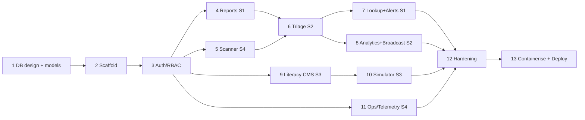

# ScamShield Cloud — Backend Build Plan (Phase by Phase)

Related: `01-project-overview.md` · `02-project-architecture.md` (rules R-x referenced below) · `03a-database-design.md`
Stack: Django 5.2 LTS · DRF · SimpleJWT · PostgreSQL 16 · boto3 · Docker.

**Order is mandatory: database design first, then foundation, then auth, then features, then hardening, then deploy.**

---

## 0. How to use this plan

- Each phase has: **Goal → Tasks → Business rules → Endpoints → Must-have tests → Definition of Done (DoD)**.
- A phase is finished only when its DoD is met and merged to `main` through a PR with passing CI.
- Owners: S1 = reports/alerts, S2 = intel/broadcasts, S3 = literacy, S4 = accounts/scanner/ops/infra/core.

### Timeline (assignment Week 7 → Week 14)

| Week | Phases | Focus |
|---|---|---|
| W7 | 0, 1A | Lecturer approval, contracts, DB design frozen |
| W8 | 1B, 2, 3 | All models + migrations, scaffold, auth; AWS base infra (VPC/RDS/ECR) by S4 |
| W9–W10 | 4–11 (parallel) | Feature backends per owner |
| W11 | 11 + integration | Cross-feature flows end to end, frontend integration |
| W12 | 12, 13 | Hardening, containerise, first full AWS deploy |
| W13 | 13 | Load test, monitoring evidence, documentation |
| W14 | – | Buffer, final report, demo rehearsal |

### Dependency map



Until Phase 3 merges, others use `APIClient.force_authenticate(user=UserFactory(role=…))` in tests so nobody is blocked.

---

## Phase 0 — Governance (no code)

**Tasks:** lecturer approves topic; register group on Moodle; obtain marking scheme; create GitHub repo, branch protection (PR + CI required), issue board; agree commit/PR conventions; read `02` rulebook together.
**Output:** signed-off topic, workload matrix (01 §12), repo skeleton.
**DoD:** all four members can run `git clone` + see the plan docs; lecturer confirmation saved.

---

## Phase 1 — Database (the gate) — **do this before any application code**

### 1A. Design (documents only)
Deliverables, all in `docs/` and reviewed by all four students:

| # | Deliverable | Source |
|---|---|---|
| 1 | Entity list + enum catalogue | `03a` §2 |
| 2 | Table specs with constraints | `03a` §4 |
| 3 | ERD (Mermaid, committed) | `03a` §3 |
| 4 | Index plan + query patterns | `03a` §5–6 |
| 5 | Transactions/concurrency rules | `03a` §7 |
| 6 | Privacy classification + retention | `03a` §8 |
| 7 | DB architecture (RDS Multi-AZ, SGs, backups, connection budget) | `03a` §9 |
| 8 | Seed/reference data list | `03a` §10 |
| 9 | **Cross-student contracts** (below) | this section |

**Cross-student contracts (freeze now):**

| Contract | Owner | Consumers |
|---|---|---|
| `core.audit.log_event(event_type, *, actor=None, ip_hash=None, target=None, metadata=None, severity="INFO")` | S4 | all |
| `core.metrics.emit(name, value=1, unit="Count", dims=None)` (non-raising) | S4 | S1, S2 |
| `core.ip.client_ip_hash(request)` | S4 | S1, S4 |
| `core.aws.client(service)` (boto3 factory with timeouts/retries) | S4 | all |
| `scanner_service.dispatch_scan(report_id)` | S4 | S1 |
| `intel.selectors.find_active_indicators(pairs)` and `count_pending_by_indicator(pairs)` | S2 | S1 (lookup) |
| `alerts` model `AlertSubscription` + `sns_service.publish_advisory()` | S1 owns subscriptions, S2 owns publish | S2 reads subscribers only through SNS (no direct SQL) |
| `literacy.selectors.guides_for_tactics(tactics)` | S3 | S3 (simulator) |
| Error codes + envelope | S4 (`core.errors`) | all |
| SNS topics (alerts, staff) | S4 creates (infra) | S1 subscribe, S2 publish |

### 1B. Implementation of the schema (code, but only models)
Tasks:
1. Create the 9 Django apps (empty `services/`, `selectors/`, `tests/`).
2. Write **all models** from `03a` with `TextChoices`, `CheckConstraint`s, explicit index names, FK `on_delete` per `03a` §1. One PR per app, reviewed by a second student.
3. `accounts.User` is created first (**custom user model before the first migration — R-A2**).
4. Generate `0001_initial` per app; add data migrations for `scanner_scannerconfig` row; seed fixtures (rules, playbooks, areas).
5. Add `factory_boy` factories for every model.
6. Constraint tests: each CHECK/UNIQUE has one failing-insert test.
7. Create `docs/erd.md` and verify the generated schema matches (`sqlmigrate`, `\d+` in psql).

**DoD:** `docker compose up` + `migrate` builds the full schema on an empty database; ERD matches reality; contracts file `docs/contracts.md` merged; all constraint tests pass.

---

## Phase 2 — Project scaffold and foundations (S4, reviewed by all)

**Tasks**
1. Repo layout from `02` §11; `requirements/{base,prod,dev}.txt` pinned; `ruff` + `pytest` config; pre-commit hooks.
2. Settings split `base/dev/prod/test`; env via `django-environ`; **prod fails fast** on missing vars/`DEBUG=True` (R-A1).
3. `docker-compose.yml`: `db` (postgres:16 with healthcheck) + `backend`; `.env.example`.
4. `core` app: `TimeStampedModel`, `StandardPagination`, error envelope + exception handler, request-id middleware (`X-Request-ID`), JSON logging config (with PII scrubber), `HealthCheckMiddleware` placed first (R-D4), `/health/` and `/health/ready/`, `core.aws.client()` with timeouts/retries (R-A6), `core.ip` (trusted-proxy depth, HMAC hash), `core.metrics`, `core.audit` stubs (real writer in Phase 3).
5. drf-spectacular configured; `openapi.yaml` committed; CI step compares.
6. GitHub Actions `ci.yml`: ruff → `makemigrations --check --dry-run` → pytest (with Postgres service) → `check --deploy` (prod settings) → schema diff → `pip-audit`.
7. Test infra: `moto` fixtures for S3/SNS/Lambda/CloudWatch; `APIClient` helpers; query-count helper.

**Must-have tests:** health endpoints; error envelope shape for 400/401/403/404/500; request-id header; IP extraction with spoofed `X-Forwarded-For`.
**DoD:** CI green on an empty feature; `docker compose up` gives a working `/api/v1/health/ready/`.

---

## Phase 3 — Accounts, authentication, RBAC (S4)

**Tasks**
1. Auth endpoints: `register` (citizen → active), `register/staff` (analyst/educator → `PENDING`), `login`, `refresh`, `logout`, `me`, `password/change`.
2. SimpleJWT config: access 15 min, refresh 7 days, rotate + blacklist; refresh token set/read via **HttpOnly Secure SameSite=Lax cookie**, path `/api/v1/auth/`; access token returned in JSON body only.
3. Permissions: `HasRole`, `IsApprovedStaff`, `IsOwnerOrAdmin`; default `IsAuthenticated`.
4. Staff approval workflow (F4.1 part 1): list pending, approve, reject (reason), role change; each audited.
5. `create_admin` management command; Argon2 hasher; password validators; login throttle (per IP + per email) using audit-table counts.
6. Real `core.audit.log_event` writer; `LOGIN_FAILURE`, `STAFF_REGISTERED`, `ROLE_APPROVED/REJECTED` events.
7. Scheduled job `flushexpiredtokens` registered in `run_jobs` (advisory-lock wrapper built here).

```python
# settings sketch
SIMPLE_JWT = {
    "ACCESS_TOKEN_LIFETIME": timedelta(minutes=15),
    "REFRESH_TOKEN_LIFETIME": timedelta(days=7),
    "ROTATE_REFRESH_TOKENS": True,
    "BLACKLIST_AFTER_ROTATION": True,
    "SIGNING_KEY": env("JWT_SIGNING_KEY"),     # not SECRET_KEY
    "AUTH_HEADER_TYPES": ("Bearer",),
}
REFRESH_COOKIE = dict(key="refresh", httponly=True, secure=True, samesite="Lax",
                      path="/api/v1/auth/", max_age=7 * 24 * 3600)
```

**Business rules:** pending/rejected staff get a clear 403 `account_not_approved`; citizens can never self-assign roles (role is ignored in public serializers); email uniqueness is case-insensitive; logout always clears the cookie even if the token is invalid.
**Must-have tests:** role × endpoint matrix (parametrised across all endpoints existing so far); refresh rotation + reuse of old refresh fails; pending staff blocked; admin-only endpoints reject others; cookie attributes.
**DoD:** frontend can log in/out/refresh against a running API; a test fails if a new endpoint is public without being on the allow-list (R-A3).

---

## Phase 4 — Reports and evidence vault, F1.1 (S1)

**Tasks**
1. `selectors/options` + `GET /reports/options/` (enums, areas, currencies).
2. **Normalisers** (`reports/normalizers.py`, pure functions, heavy unit tests):

| Type | Rule |
|---|---|
| Phone | Parse with `phonenumbers` using submitted country as default region; keep only possible numbers; output E.164 (`+60…`, `+977…`) |
| URL | Add scheme if missing; lower-case host; punycode IDN; drop `utm_*`, `fbclid`, `gclid`, fragment, default ports, trailing slash; store scheme-less canonical form |
| Domain | Registrable domain via `tldextract` using the **bundled snapshot (offline)**; also created automatically from every URL |
| Email | Trim + lower-case; reject invalid format |
| Bank account | Strip spaces/dashes; store **HMAC** as `normalized_value`; mask in `display_value` |

3. `report_service.create_report()`:
   - Validate: ≥ 1, ≤ 5 indicators; message ≤ 5000; loss ≥ 0; category/platform enums.
   - Anonymous: no reporter, generate access key (shown once, store hash). Logged-in: reporter set.
   - Idempotency: `client_submission_id` unique; replay returns the original response.
   - Evidence: ≤ 3 files, ≤ 5 MB each, check **magic bytes** (PNG/JPEG/PDF), re-encode/strip EXIF for images, compute SHA-256, key `evidence/{report_id}/{uuid}.{ext}`, upload with `ServerSideEncryption`, private.
   - One `atomic` block for DB rows; upload before commit with cleanup on failure (`03a` §7).
   - Reference code: random base32 with collision retry.
   - `transaction.on_commit` → `scanner_service.dispatch_scan` (stub until Phase 5) + `metrics.emit("ReportsSubmitted")` + audit `REPORT_SUBMITTED` (this row is also the rate-limit counter).
4. Anonymous rate limit: ≤ 5 reports per `ip_hash` per hour (count from audit table, R-C6); logged-in users ≤ 20/hour per user; block → audit `RATE_LIMIT_BLOCK` + metric + 429 with `Retry-After`.
5. Playbook selection (`reports/selectors.py`): most specific active playbook for (category, payment method, country); bank-transfer with loss > 0 always includes the bank-freeze steps and hotlines.
6. `POST /reports/track/` (reference + access key), `GET /reports/mine/` (logged-in only).
7. Orphan-upload cleanup job (keys older than 24 h with no DB row).

**Endpoints:** `GET /reports/options/`, `POST /reports/`, `POST /reports/track/`, `GET /reports/mine/`.
**Business rules:** public/anonymous responses never include raw IP, internal IDs, risk score, or analyst notes; tracking returns only status and reference; responses are identical for "wrong key" and "unknown reference" (no enumeration).
**Must-have tests:** each normaliser (≥ 10 cases per type, including MY/NP numbers and hostile URLs); upload validation (wrong type, fake extension, oversize, too many files, path-traversal filename); idempotent replay; rate limit boundary (5th ok, 6th blocked; other IP unaffected); anonymous report has `reporter_id IS NULL` and no IP anywhere; S3 object private and key format (moto).
**DoD:** end-to-end report with 2 screenshots creates rows + S3 objects; returns reference + playbook; query count asserted.

---

## Phase 5 — Heuristic scanner, F4.1 (S4)

**Tasks**
1. Rule CRUD (`/admin-portal/rules/`) and config endpoint; every write bumps `ruleset_version` in the same transaction and audits (`RULE_CHANGED`).
2. `scanner_service.dispatch_scan(report_id)`: build payload `{report_id, message_text, indicators[], rules[], config, ruleset_version, prior_pending_counts{}}`; `lambda.invoke(InvocationType="Event")`; update `scan_dispatched_at`, `scan_attempts`; never raise.
3. **Lambda** (`backend/lambda/heuristic_scanner`): pure function + handler; no DB, no VPC; POSTs signed callback; logs JSON; timeout ≤ 10 s; reserved concurrency; DLQ.

```python
# scoring.py (pure, unit-tested)
import re, ipaddress

def score(p):
    cfg, rules, text = p["config"], p["rules"], p["message_text"].lower()
    items = []
    kw = 0
    for r in rules["KEYWORD"]:                       # whole-word match: "otp" must not match "hotpot"
        if re.search(rf"(?<!\w){re.escape(r['pattern'])}(?!\w)", text):
            kw += r["weight"]; items.append(("KEYWORD", r["pattern"], r["weight"]))
    kw = min(kw, cfg["keyword_cap_points"])
    hosts = [i["host"] for i in p["indicators"] if i["type"] in ("URL", "DOMAIN")]
    tld = max([r["weight"] for r in rules["TLD"] if any(h.endswith(r["pattern"]) for h in hosts)], default=0)
    ip_url = cfg["ip_url_points"] if any(_is_ip(h) for h in hosts) else 0
    short = max([r["weight"] for r in rules["SHORTENER"] if any(h == r["pattern"] or h.endswith("." + r["pattern"]) for h in hosts)], default=0)
    prior = cfg["prior_pending_points"] if any(v > 0 for v in p["prior_pending_counts"].values()) else 0
    total = min(100, kw + max(tld, ip_url) + short + prior)
    return total, total >= cfg["high_priority_threshold"], items

def _is_ip(h):
    try: ipaddress.ip_address(h); return True
    except ValueError: return False
```

4. **Callback endpoint** `POST /internal/scan-results/`: HMAC verification, ±5 min clock skew, constant-time compare, idempotent, saves `ScanResult`, updates report fields, `scan_status=DONE`, publishes to the staff topic if high priority.

```python
def verify_signature(request, secret: bytes):
    ts, sig = request.headers.get("X-Timestamp", ""), request.headers.get("X-Signature", "")
    if not ts.isdigit() or abs(time.time() - int(ts)) > 300:
        raise PermissionDenied("stale")
    expected = hmac.new(secret, ts.encode() + b"." + request.body, hashlib.sha256).hexdigest()
    if not hmac.compare_digest(expected, sig):
        raise PermissionDenied("bad signature")
```

5. `run_jobs`: re-dispatch reports with `scan_status=PENDING` older than 5 min (max 5 attempts → `FAILED` + audit `SCAN_FAILED` + metric); advisory-locked.
6. Deploy Lambda (zip or container) with env: callback URL, secret read from SSM at cold start.

**Must-have tests:** scoring table (each rule alone, cap at 45, cap total 100, threshold 75 boundary at 74/75, IP URL, shortener, prior pending, whole-word matching); callback rejects bad/stale signature; callback idempotent; dispatch failure leaves report saved and `PENDING`; re-dispatch job; rule change bumps version.
**DoD:** submitting a report from Phase 4 produces a risk score within seconds on AWS (and via moto/local stub in tests); high-priority flag + staff alert work.

---

## Phase 6 — Triage workbench, F2.1 (S2)

**Tasks**
1. Queue: `GET /triage/queue/` — pending only; order by `risk_score DESC NULLS LAST`, cluster size, `created_at`; filters (platform, category, high-priority, min score); paginated; annotated with `cluster_size`.
2. Detail: `GET /triage/reports/{id}/` returns full analyst serializer (raw indicators, message, scan breakdown, related reports count).
3. Evidence: `GET /triage/reports/{id}/evidence/` → list of pre-signed `get_object` URLs (`ExpiresIn=900`), analyst only, audit `EVIDENCE_URL_ISSUED` per request.
4. `triage_service.verify_indicator()` (below), `reject_report()`, `revoke_indicator()`.
5. Indicators list/detail + public-note editing (curated, max 500 chars).

```python
@transaction.atomic
def verify_indicator(*, analyst, report_id, report_indicator_id, public_note=""):
    src = ReportIndicator.objects.select_related("report").get(pk=report_indicator_id, report_id=report_id)
    if src.report.status != ReportStatus.PENDING:
        raise Conflict("report_already_resolved")
    key = dict(type=src.type, normalized_value=src.normalized_value)

    ids = list(ScamReport.objects.filter(status=ReportStatus.PENDING, indicators__type=src.type,
               indicators__normalized_value=src.normalized_value).values_list("id", flat=True).distinct())
    reports = list(ScamReport.objects.select_for_update().filter(id__in=ids, status=ReportStatus.PENDING).order_by("id"))
    n, now = len(reports), timezone.now()
    newest = max(r.created_at for r in reports)

    vi, created = VerifiedIndicator.objects.select_for_update().get_or_create(
        **key, defaults=dict(display_value=src.display_value, primary_category=src.report.category,
        total_report_count=n, first_seen_at=min(r.created_at for r in reports), last_seen_at=newest,
        threat_level=threat_level_for(n), verified_by=analyst, verified_at=now, public_note=public_note))
    if not created:
        VerifiedIndicator.objects.filter(pk=vi.pk).update(
            total_report_count=F("total_report_count") + n, last_seen_at=Greatest(F("last_seen_at"), newest),
            status=IndicatorStatus.ACTIVE, updated_at=now)
        vi.refresh_from_db()
        VerifiedIndicator.objects.filter(pk=vi.pk).update(threat_level=threat_level_for(vi.total_report_count))

    ScamReport.objects.filter(id__in=[r.id for r in reports]).update(
        status=ReportStatus.VERIFIED, reviewed_by=analyst, reviewed_at=now)
    ReportIndicator.objects.filter(report_id__in=[r.id for r in reports], **key).update(verified_indicator=vi)
    TriageDecision.objects.bulk_create([TriageDecision(report=r, analyst=analyst, action="VERIFY", indicator=vi) for r in reports])
    audit.log_event("INDICATOR_VERIFIED", actor=analyst, target=vi, metadata={"reports": n})
    transaction.on_commit(lambda: metrics.emit("IndicatorsVerified"))
    return vi

def threat_level_for(count):  # 1-2 MEDIUM, 3-9 HIGH, 10+ CRITICAL
    return "CRITICAL" if count >= 10 else "HIGH" if count >= 3 else "MEDIUM"
```

**Business rules:** only `PENDING` reports can be verified/rejected (409 otherwise); reject needs a reason; revoke needs a reason and sets status `REVOKED` (lookup then no longer shows Red); re-verifying a revoked indicator reactivates it; analysts cannot edit victim content; admin has read-only access.
**Must-have tests:** cluster of 3 reports → one indicator with count 3, level HIGH, all three `VERIFIED`; second verify adds count and escalates 3→10 = CRITICAL; two concurrent verifications don't double count or deadlock (threaded test); evidence URL expiry ≤ 900 s and 403 for non-analysts; each action writes audit + decision rows; N+1 query test on queue.
**DoD:** analyst can clear a seeded queue end to end via API; public lookup (Phase 7) reflects the change immediately.

---

## Phase 7 — Public lookup and alert subscriptions, F1.2 (S1)

**Tasks**
1. `POST /lookups/` body `{query}`: detect candidate types (URL/domain, phone, email, bank account — a number may be both phone and account, so check each), normalise with Phase 4 functions, search blacklist (also the **domain** of a URL), then pending reports.
2. Verdict logic (`lookup_service.py`):

| Condition | Verdict | Response |
|---|---|---|
| Active `VerifiedIndicator` | RED | `report_count`, `primary_category`, `first_seen_at`, `last_seen_at`, `threat_level`, `public_note` |
| Else pending reports ≥ 1 **or** any high-priority scan | YELLOW | counts only ("reported, awaiting verification") |
| Else | GREEN | caution banner text |

3. Public response never includes victim text, raw values, report IDs, or evidence (R-C8); input never logged (R-C5); throttle ~30/min per IP.
4. Subscriptions: `POST /alerts/subscriptions/` creates row `PENDING_CONFIRMATION`, calls `sns.subscribe` with filter policy `{"audience": ["ALL", <group>], "category": [<categories>]}` (omit `category` key when "all"), stores ARN; `confirm` and `unsubscribe` endpoints use hashed tokens; duplicate subscription returns the existing one without leaking whether it existed.
5. SMS channel behind a feature flag; validate E.164; show the SNS limitation clearly in the response if disabled.

**Must-have tests:** each verdict path; URL whose domain is blacklisted → RED; revoked indicator → not RED; response schema never contains forbidden fields (snapshot test); subscribe with moto SNS creates the correct filter policy; duplicate/unsubscribe flows; throttling.
**DoD:** pasting a seeded scam number shows RED within p95 < 300 ms locally; subscribing returns a pending status and the SNS subscription exists.

---

## Phase 8 — Trend analytics and emergency broadcast, F2.2 (S2)

**Tasks**
1. Analytics selectors (ORM `annotate(Count, Sum)` + `TruncDate`) returning chart-ready JSON: volume by platform/category/day; losses by country/area; top tactics (from `scan_result.breakdown` keyword/tactic mapping or report category if tactics unavailable); `spikes` (last 24 h vs trailing 7-day daily average per platform/category, flag ≥ +300% with a minimum count threshold to avoid noise).
2. Date-range params validated (max range 90 days); cache aggregate responses 60 s via DB cache table or short-lived per-request memo (no process-local cache that would differ across instances — R-C6 principle).
3. Advisories: create (DRAFT), edit (DRAFT only), publish.
   `broadcast_service.publish_advisory()`: `atomic` status change → on commit `sns.publish(TopicArn, Subject, Message, MessageAttributes={"audience":…, "category":…})` with timeout; store `sns_message_id`; on SNS failure set `FAILED` (retryable by the analyst) + audit/metric — never leaves a half-published state.
4. Public `GET /advisories/` lists published advisories (pagination).

**Must-have tests:** aggregation correctness with fixed fixtures (counts and sums); spike math boundaries; publish success/failure paths with moto; only DRAFT editable; publish sends right attributes; double-click publish is idempotent (second call returns 409, one SNS publish).
**DoD:** analyst dashboards load < 1 s on the demo dataset; a published advisory reaches a confirmed email subscriber via SNS filter.

---

## Phase 9 — Literacy CMS, F3.1 (S3)

**Tasks**
1. Guide CRUD (`/studio/guides/`): educator owns own guides; admin all; slug generation unique; markdown body stored raw, sanitised on output (bleach/`nh3`) — never trust HTML.
2. Assets: upload PDF/audio/image (type allow-list by magic bytes, size caps: PDF ≤ 10 MB, audio ≤ 20 MB, image ≤ 5 MB), UUID key under `guides/{guide_id}/`, `alt_text` required for images, `transcript` recommended for audio; delete removes S3 object.
3. Public hub: `GET /guides/?group=ELDERLY&language=ne&tactic=URGENCY` (published only) with `ui_hints` in the response: for `ELDERLY` → `{"base_font_px": 20, "high_contrast": true, "tts": true}`; asset URLs are `/media/guides/…` (CloudFront path) — API never returns raw S3 URLs.
4. Publish/unpublish/archive workflow; `published_at` set once.

**Must-have tests:** ownership rules (educator A can't edit B's guide); upload validation; filters (GIN-backed queries use arrays correctly); public endpoint hides drafts; XSS payload in body is neutralised; asset URL format.
**DoD:** educator creates → uploads → publishes; guide appears in public API filtered by group, with correct `/media/` URLs.

---

## Phase 10 — "Spot the Scam" simulator, F3.2 (S3)

**Tasks**
1. Scenario CRUD (`/studio/scenarios/`): screenshot upload (`scenarios/{uuid}.{ext}`, PNG/JPEG ≤ 5 MB), `is_scam`, tactic (`NONE` required when legitimate — DB CHECK), explanation, difficulty, red-flag hotspot CRUD (percent coordinates validated 0–100 and inside image bounds); publish requires ≥ 1 red flag for scam scenarios; archive instead of delete once answered.
2. `POST /simulator/attempts/`: pick **5 random published scenarios server-side** (mix of scam/legit, `ORDER BY random()` on small set or sampled IDs), create attempt (`session_key` for anonymous players), return scenario cards **without** `is_scam`, `tactic`, flags, or explanation.
3. `POST /simulator/attempts/{id}/answers/`: body `{scenario_id, is_scam, flag_code?}`; grading server-side: correct if `is_scam` matches and, for scams, `flag_code` ∈ scenario's red-flag codes; response may reveal correctness + explanation for **that** scenario only after answering.
4. `POST /simulator/attempts/{id}/complete/`: needs 5 answers; compute `score_pct`, per-tactic profile; blind spots = tactics with ≥ 2 misses (rule from proposal); recommend guides via `guides_for_tactics()` (published only, language match first); store result; attempt becomes immutable.
5. Ownership: logged-in attempts only readable by owner; anonymous by `session_key` header/cookie.

**Must-have tests:** answers never leaked before submission (schema test); grading matrix (scam+right flag, scam+wrong flag, legit+scam answer, etc.); can't answer twice or after completion; blind-spot rule (exactly 2 misses triggers, 1 doesn't); remedial guides only published and tactic-matched; random selection returns 5 distinct scenarios; not enough published scenarios → clear 409.
**DoD:** full play-through via API returns score, blind spots, and recommended guides.

---

## Phase 11 — Ops and telemetry, F4.2 (S4)

**Tasks**
1. `cloudwatch_service.py`: `put_metrics()` (batched, timeouts, non-raising) and `get_dashboard_series()` using `get_metric_data` for `AWS/EC2` (CPU), `AWS/ApplicationELB` (5xx, latency, healthy hosts), `AWS/RDS` (CPU, connections, free storage, free memory), and `ScamShield/Operations` custom metrics; last 24 h, `Period=300`; response cached ~60 s.
2. Emit custom metrics from services (`ReportsSubmitted`, `ReportsHighPriority`, `AlertsPublished`, `RateLimitBlocks`, `ScanFailures`, `LoginFailures`); a `run_jobs` task pushes aggregate counts as a fallback if immediate emits were dropped.
3. `GET /admin-portal/telemetry/metrics/?range=24h` → chart-ready series; `GET /admin-portal/audit-logs/` with filters (event type, severity, date, actor, ip hash prefix) + pagination; export CSV optional.
4. Audit retention purge job (see `03a` §8); log-group retention verified in infra.
5. CloudWatch alarms + dashboard definition kept in `infra/` (so evidence for the report is reproducible).

**Must-have tests:** metric emit never raises when AWS fails; series transformation (moto/fake responses); admin-only; audit filters and pagination; purge job respects retention windows.
**DoD:** admin sees live EC2/RDS charts and business metrics on AWS; alarms visible; dashboard screenshot captured.

---

## Phase 12 — Hardening and performance (all, S4 leads)

**Checklist**
1. **Security:** run `manage.py check --deploy` (prod settings); OWASP checklist per endpoint group; confirm public serializers expose no forbidden fields; test auth bypass attempts (IDOR on report, guide, attempt); verify Django admin/browsable API disabled; verify no secrets in repo (`gitleaks`/`trufflehog`).
2. **Performance:** `assertNumQueries` on queue, lookup, hub, analytics; EXPLAIN key queries against a seeded dataset (e.g. 100k reports) and confirm planned indexes are used (`03a` §6); tune gunicorn workers/threads.
3. **Concurrency:** threaded tests for verify, rate limit, idempotent submit.
4. **Resilience:** simulate failures (Lambda down, SNS down, CloudWatch down, S3 throttled) — each must degrade as designed (report still saved, advisory marked FAILED, metrics dropped).
5. **Load test** (k6/Locust): scenarios — 70% lookup, 20% hub browse, 8% report submit, 2% simulator; 100 concurrent users, 10 minutes; record p50/p95/p99, error rate, ASG scale-out events, RDS connections; keep graphs for CLO2 evidence.
6. **OpenAPI freeze:** commit `openapi.yaml`; frontend regenerates types.

**DoD:** zero high-severity findings; targets in `01` §3 met or deviations documented with cause.

---

## Phase 13 — Containerise and deploy (S4 leads, all verify)

**Tasks**
1. Production `Dockerfile` per `02` §13; `.dockerignore`; image builds in CI; Trivy/Grype scan (fail on critical).
2. Push to ECR by git SHA; run container locally against RDS-like Postgres to verify `prod` settings boot.
3. Infra (IaC or scripted runbook): VPC, subnets, endpoints, SGs, RDS Multi-AZ, S3 buckets + policies, CloudFront (3 behaviours + OAC + response headers policy), ALB (secret-header rule), launch template (user-data), ASG + scaling policy, SNS topics, Lambda + DLQ, SSM parameters, IAM roles, CloudWatch dashboard/alarms, AWS Budgets.
4. Deployment pipeline per `02` §14: migrate once via SSM Run Command → update `IMAGE_TAG` → instance refresh → smoke tests → SPA sync.
5. `docs/runbook.md`: deploy, rollback, restore DB from PITR, rotate secrets, scale up/down, shut down to save cost.
6. Smoke test script: `/health/ready/`, login, lookup, report submit, scan callback observed, triage verify, advisory publish to a test subscriber.
7. Kill-an-instance test and failover test (reboot RDS with failover) — capture evidence for the report.

**DoD:** public URL serves SPA + API; killing one instance causes no user-visible outage; rollback rehearsed; evidence screenshots (ASG, ALB healthy targets, RDS Multi-AZ, CloudWatch dashboard, SNS delivery, Lambda logs) saved.

---

## Global Definition of Done (every PR)

- [ ] Business rules implemented in `services/`; views thin (R-A5)
- [ ] Permissions explicit; role × endpoint tests updated
- [ ] Serializers use explicit fields; no forbidden fields in public output
- [ ] Migrations backward-compatible; index names explicit
- [ ] AWS calls: timeouts, `on_commit`, failure-tolerant (R-A6)
- [ ] No PII in logs/metrics/audit metadata
- [ ] Tests: happy path + failure paths + permission paths; coverage ≥ 80% on `services/` and `selectors/`
- [ ] OpenAPI regenerated and committed
- [ ] CI green; second reviewer approved

## Local commands cheat sheet

```bash
docker compose up -d db
docker compose run --rm backend python manage.py migrate
docker compose run --rm backend python manage.py create_admin
docker compose run --rm backend pytest -q
docker compose run --rm backend python manage.py makemigrations --check --dry-run
docker compose run --rm backend python manage.py spectacular --file openapi.yaml
DJANGO_SETTINGS_MODULE=config.settings.prod python manage.py check --deploy
```
