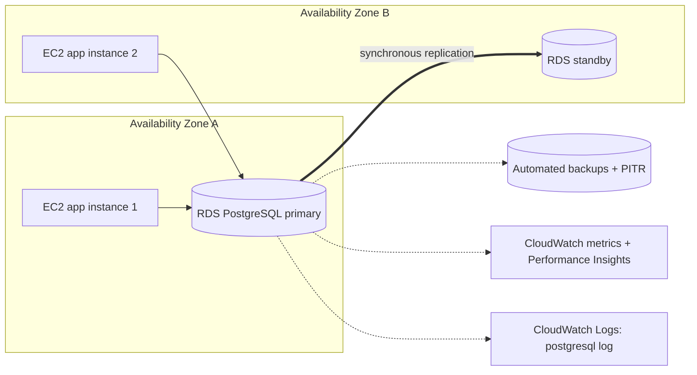

# ScamShield Cloud — Database Design (Schema, ERD, DB Architecture)

Related: `01-project-overview.md` · `02-project-architecture.md` · `03-backend-build-plan.md`
**Gate:** no backend code is written until the team has reviewed and frozen this document (Phase 1 of the build plan).

---

## 1. Design principles and conventions

| Topic | Rule |
|---|---|
| Engine | PostgreSQL 16 (RDS). Schema owned by **Django models + migrations** (not Prisma) |
| Primary keys | `uuid` (v4) for anything exposed in URLs/APIs; `bigint` identity for internal high-volume rows |
| Time | `timestamptz`, stored UTC (`USE_TZ=True`); `created_at` / `updated_at` on mutable tables via abstract `TimeStampedModel` |
| Enums | Django `TextChoices` stored as `varchar` + DB `CHECK` constraint (easier to migrate than native PG enums) |
| Arrays / JSON | `varchar[]` (with GIN index) for small tag sets; `jsonb` for flexible breakdowns |
| Integrity | Constraints in the DB (unique, check, FK), not only in serializers |
| Naming | Django default table names `app_model`; explicit index names `idx_<table>_<cols>` |
| Deletes | Staff FKs `PROTECT` (deactivate users, don't delete); citizen-linked FKs `SET_NULL`; children of a report `CASCADE`; content referenced by history is **archived**, not deleted |
| Money | `numeric(12,2)` + ISO currency code; never float |
| PII | Minimised; classified in Section 8; anonymous reports have no user link |

## 2. Enum catalogue (frozen contract)

| Enum | Values |
|---|---|
| Role | `CITIZEN`, `ANALYST`, `EDUCATOR`, `ADMIN` |
| ApprovalStatus | `APPROVED`, `PENDING`, `REJECTED` |
| ScamCategory | `PHISHING`, `FAKE_JOB`, `ECOMMERCE_FRAUD`, `IMPERSONATION`, `OTHER` |
| Platform | `WHATSAPP`, `TELEGRAM`, `FACEBOOK`, `EMAIL`, `SMS`, `WEBSITE`, `OTHER` |
| IndicatorType | `PHONE`, `URL`, `DOMAIN`, `EMAIL`, `BANK_ACCOUNT` |
| PaymentMethod | `NONE`, `BANK_TRANSFER`, `E_WALLET`, `CARD`, `CRYPTO`, `CASH`, `OTHER` |
| ReportStatus | `PENDING`, `VERIFIED`, `REJECTED` |
| ScanStatus | `PENDING`, `DONE`, `FAILED` |
| ThreatLevel | `MEDIUM` (1–2 reports), `HIGH` (3–9), `CRITICAL` (10+) |
| IndicatorStatus | `ACTIVE`, `REVOKED` |
| TriageAction | `VERIFY`, `REJECT` |
| Audience | `GENERAL`, `SENIOR_FAMILY`, `TEENAGER`, `NON_TECH` (advisories also allow `ALL`) |
| Channel | `EMAIL`, `SMS` |
| SubscriptionStatus | `PENDING_CONFIRMATION`, `ACTIVE`, `UNSUBSCRIBED`, `FAILED` |
| AdvisorySeverity / Status | `INFO`,`WARNING`,`CRITICAL` / `DRAFT`,`PUBLISHED`,`FAILED` |
| TargetGroup | `ELDERLY`, `TEENAGER`, `NON_TECH`, `GENERAL` |
| Tactic | `URGENCY`, `AUTHORITY`, `FEAR`, `GREED` (+ `NONE` on scenarios) |
| Language | `en`, `ne`, `ms` |
| ReadabilityMode | `STANDARD`, `LARGE_HIGH_CONTRAST` |
| ContentStatus (guide) | `DRAFT`, `PUBLISHED`, `ARCHIVED` |
| ScenarioStatus | `DRAFT`, `PUBLISHED`, `ARCHIVED` |
| ScenarioChannel | `SMS`, `EMAIL`, `WHATSAPP`, `WEBSITE`, `SOCIAL` |
| AssetType | `PDF`, `AUDIO`, `IMAGE` |
| RedFlagCode | `MISMATCHED_DOMAIN`, `ARTIFICIAL_URGENCY`, `AUTHORITY_IMPERSONATION`, `THREAT_OF_LOSS`, `TOO_GOOD_TO_BE_TRUE`, `REQUEST_FOR_SENSITIVE_DATA`, `SUSPICIOUS_LINK`, `POOR_GRAMMAR`, `OTHER` |
| RuleType | `KEYWORD`, `TLD`, `SHORTENER` |
| AttemptStatus | `IN_PROGRESS`, `COMPLETED` |
| AuditSeverity | `INFO`, `WARN`, `ALERT` |

## 3. Entity-relationship diagram

```mermaid
erDiagram
    USER |o--o{ USER : approves
    USER |o--o{ SCAM_REPORT : files
    USER |o--o{ SCAM_REPORT : reviews
    SCAM_REPORT ||--|{ REPORT_INDICATOR : has
    SCAM_REPORT ||--o{ REPORT_EVIDENCE : has
    SCAM_REPORT ||--o| SCAN_RESULT : scanned_as
    SCAM_REPORT ||--o{ TRIAGE_DECISION : decided_by
    USER ||--o{ TRIAGE_DECISION : makes
    VERIFIED_INDICATOR |o--o{ REPORT_INDICATOR : promoted_from
    VERIFIED_INDICATOR |o--o{ TRIAGE_DECISION : result_of
    USER ||--o{ VERIFIED_INDICATOR : verifies
    VERIFIED_INDICATOR |o--o{ THREAT_ADVISORY : mentioned_in
    USER ||--o{ THREAT_ADVISORY : authors
    USER |o--o{ ALERT_SUBSCRIPTION : owns
    USER ||--o{ EDUCATIONAL_GUIDE : authors
    EDUCATIONAL_GUIDE ||--o{ GUIDE_ASSET : has
    USER ||--o{ SIMULATOR_SCENARIO : authors
    SIMULATOR_SCENARIO ||--o{ SCENARIO_RED_FLAG : has
    USER |o--o{ SIMULATOR_ATTEMPT : plays
    SIMULATOR_ATTEMPT ||--|{ ATTEMPT_ANSWER : contains
    SIMULATOR_SCENARIO ||--o{ ATTEMPT_ANSWER : answered_in
    USER ||--o{ HEURISTIC_RULE : manages
    USER |o--o| SCANNER_CONFIG : updates
    USER |o--o{ SYSTEM_AUDIT_LOG : acts_in

    USER {
        uuid id PK
        string email UK
        string role
        string approval_status
        string organization
        uuid approved_by FK
        boolean is_active
    }
    SCAM_REPORT {
        uuid id PK
        string reference_code UK
        uuid client_submission_id UK
        uuid reporter_id FK
        boolean is_anonymous
        string category
        string platform
        text message_text
        decimal financial_loss
        string currency
        string payment_method
        string country_code
        string status
        int risk_score
        boolean is_high_priority
        string scan_status
        timestamptz created_at
    }
    REPORT_INDICATOR {
        bigint id PK
        uuid report_id FK
        string type
        string raw_value
        string normalized_value
        uuid verified_indicator_id FK
    }
    REPORT_EVIDENCE {
        uuid id PK
        uuid report_id FK
        string s3_key UK
        string content_type
        int size_bytes
        string sha256
    }
    SCAN_RESULT {
        bigint id PK
        uuid report_id FK
        int ruleset_version
        int risk_score
        jsonb breakdown
        boolean is_high_priority
    }
    TRIAGE_DECISION {
        bigint id PK
        uuid report_id FK
        uuid analyst_id FK
        string action
        uuid indicator_id FK
        string reason
    }
    VERIFIED_INDICATOR {
        uuid id PK
        string type
        string normalized_value
        string threat_level
        int total_report_count
        timestamptz first_seen_at
        timestamptz last_seen_at
        string status
        string public_note
        uuid verified_by FK
    }
    RECOVERY_PLAYBOOK {
        bigint id PK
        string category
        string payment_method
        string country_code
        jsonb steps
        jsonb hotlines
    }
    ALERT_SUBSCRIPTION {
        uuid id PK
        uuid user_id FK
        string channel
        string endpoint_hash
        string audience
        string_array categories
        string status
        string sns_subscription_arn
    }
    THREAT_ADVISORY {
        uuid id PK
        string title
        text body
        string severity
        string target_audience
        string status
        string sns_message_id
        uuid created_by FK
        uuid related_indicator FK
    }
    EDUCATIONAL_GUIDE {
        uuid id PK
        string slug UK
        string title
        string_array target_groups
        string_array tactics
        string language
        string readability_mode
        string status
        uuid author_id FK
    }
    GUIDE_ASSET {
        uuid id PK
        uuid guide_id FK
        string asset_type
        string s3_key UK
        string alt_text
    }
    SIMULATOR_SCENARIO {
        uuid id PK
        string channel
        boolean is_scam
        string tactic
        string image_s3_key
        string status
        uuid author_id FK
    }
    SCENARIO_RED_FLAG {
        bigint id PK
        uuid scenario_id FK
        string flag_code
        decimal x_pct
        decimal y_pct
        decimal w_pct
        decimal h_pct
    }
    SIMULATOR_ATTEMPT {
        uuid id PK
        uuid user_id FK
        uuid session_key
        string status
        int score_pct
        jsonb profile
    }
    ATTEMPT_ANSWER {
        bigint id PK
        uuid attempt_id FK
        uuid scenario_id FK
        boolean answered_is_scam
        string selected_flag_code
        boolean is_correct
    }
    HEURISTIC_RULE {
        bigint id PK
        string rule_type
        string pattern
        int weight
        boolean is_active
        uuid created_by FK
    }
    SCANNER_CONFIG {
        int id PK
        int keyword_cap_points
        int ip_url_points
        int prior_pending_points
        int high_priority_threshold
        int ruleset_version
    }
    SYSTEM_AUDIT_LOG {
        bigint id PK
        timestamptz occurred_at
        uuid actor_id FK
        string actor_ip_hash
        string event_type
        string severity
        jsonb metadata
    }
```

Standalone/infra tables: `RECOVERY_PLAYBOOK` (reference data), SimpleJWT `token_blacklist_*` tables, Django `django_migrations`/`auth` tables.

## 4. Table specifications

### 4.1 `accounts_user` (S4 owns; shared)
| Column | Type | Constraints / notes |
|---|---|---|
| id | uuid | PK |
| email | varchar(254) | login; **unique on `lower(email)`** |
| password | varchar(128) | Argon2 hash |
| full_name | varchar(150) | |
| role | varchar(10) | CHECK in Role; default `CITIZEN` |
| approval_status | varchar(10) | CHECK; `APPROVED` for citizens, `PENDING` for staff sign-ups |
| organization | varchar(200) | null; required for staff sign-up |
| credential_note | text | null; staff justification (≤ 1000 chars) |
| approved_by_id | uuid | FK → user, null, SET_NULL |
| approved_at | timestamptz | null |
| rejection_reason | varchar(300) | null |
| is_active | boolean | default true |
| is_superuser | boolean | default false (Django auth requirement; Django admin disabled in prod) |
| last_login | timestamptz | null |
| created_at / updated_at | timestamptz | |
CHECK: `role = 'CITIZEN' → approval_status = 'APPROVED'`.

### 4.2 `reports_scamreport` (S1)
| Column | Type | Constraints / notes |
|---|---|---|
| id | uuid | PK |
| reference_code | varchar(24) | UNIQUE; `SCM-<year>-<8 random base32>` |
| client_submission_id | uuid | UNIQUE, null; idempotency key |
| reporter_id | uuid | FK → user, null, SET_NULL |
| is_anonymous | boolean | CHECK `NOT (is_anonymous AND reporter_id IS NOT NULL)` |
| access_key_hash | varchar(128) | null; only for anonymous reports |
| category | varchar(20) | CHECK ScamCategory |
| platform | varchar(12) | CHECK Platform |
| message_text | text | ≤ 5000 chars (CHECK `char_length ≤ 5000`) |
| financial_loss | numeric(12,2) | default 0, CHECK ≥ 0 |
| currency | char(3) | ISO 4217 (MYR, NPR, USD…) |
| payment_method | varchar(15) | default `NONE` |
| country_code | char(2) | ISO 3166-1 alpha-2 |
| admin_area | varchar(100) | null; from an allow-list (state/province) |
| incident_date | date | null |
| status | varchar(10) | default `PENDING` |
| risk_score | smallint | null; CHECK 0–100 (denormalised from `scan_result`, single writer = scan callback) |
| is_high_priority | boolean | default false |
| scan_status | varchar(10) | default `PENDING` |
| scan_attempts | smallint | default 0 |
| scan_dispatched_at | timestamptz | null |
| reviewed_by_id | uuid | FK → user, null, SET_NULL |
| reviewed_at | timestamptz | null |
| review_note | varchar(500) | null |
| created_at / updated_at | timestamptz | |

### 4.3 `reports_reportindicator` (S1)
| Column | Type | Constraints / notes |
|---|---|---|
| id | bigint | PK identity |
| report_id | uuid | FK → report, CASCADE |
| type | varchar(12) | CHECK IndicatorType |
| raw_value | varchar(512) | as submitted (analyst-only exposure) |
| normalized_value | varchar(512) | E.164 / canonical URL / lower-case domain / lower-case email / **HMAC-SHA256 hex for BANK_ACCOUNT** |
| display_value | varchar(128) | masked for public use (`+60•••••789`, `lazada-p••••.xyz`) |
| verified_indicator_id | uuid | FK → verified_indicator, null, SET_NULL |
| created_at | timestamptz | |
UNIQUE `(report_id, type, normalized_value)`.
A URL submission also creates a `DOMAIN` row (registrable domain extracted offline with `tldextract`).

### 4.4 `reports_reportevidence` (S1)
| Column | Type | Constraints / notes |
|---|---|---|
| id | uuid | PK |
| report_id | uuid | FK CASCADE |
| s3_key | varchar(300) | UNIQUE; `evidence/{report_id}/{uuid}.{ext}` |
| content_type | varchar(40) | `image/png`, `image/jpeg`, `application/pdf` (CHECK) |
| size_bytes | integer | CHECK 1..5242880 |
| sha256 | char(64) | integrity / duplicate-evidence detection |
| created_at | timestamptz | |
Max 3 per report (enforced in service + test).

### 4.5 `reports_recoveryplaybook` (S1, reference data)
| Column | Type | Notes |
|---|---|---|
| id | bigint | PK |
| category / payment_method / country_code | varchar | null = "any" |
| title | varchar(150) | |
| steps | jsonb | ordered `[{"title","detail"}]` |
| hotlines | jsonb | `[{"name","number","url"}]` — **verify numbers from official sources before seeding** |
| priority | smallint | more specific rule wins; ties by priority |
| is_active | boolean | |
| updated_at | timestamptz | |

### 4.6 `intel_verifiedindicator` (S2)
| Column | Type | Constraints / notes |
|---|---|---|
| id | uuid | PK |
| type | varchar(12) | CHECK IndicatorType |
| normalized_value | varchar(512) | |
| display_value | varchar(128) | masked, public |
| primary_category | varchar(20) | most frequent category among linked reports |
| threat_level | varchar(10) | `MEDIUM` / `HIGH` / `CRITICAL` |
| total_report_count | integer | CHECK ≥ 1 |
| first_seen_at / last_seen_at | timestamptz | |
| status | varchar(8) | default `ACTIVE` |
| public_note | varchar(500) | analyst-curated, redacted; shown on Red verdicts |
| verified_by_id | uuid | FK → user, PROTECT |
| verified_at | timestamptz | |
| revoked_by_id / revoked_at / revoke_reason | uuid / timestamptz / varchar(300) | null |
| created_at / updated_at | timestamptz | |
UNIQUE `(type, normalized_value)`.

### 4.7 `intel_triagedecision` (S2)
| Column | Type | Notes |
|---|---|---|
| id | bigint | PK |
| report_id | uuid | FK CASCADE |
| analyst_id | uuid | FK → user, PROTECT |
| action | varchar(8) | `VERIFY` / `REJECT` |
| indicator_id | uuid | FK → verified_indicator, null, SET_NULL |
| reason | varchar(500) | required for `REJECT` |
| created_at | timestamptz | |

### 4.8 `alerts_alertsubscription` (S1)
| Column | Type | Constraints / notes |
|---|---|---|
| id | uuid | PK |
| user_id | uuid | FK null SET_NULL |
| channel | varchar(5) | `EMAIL` / `SMS` |
| endpoint | varchar(254) | email or E.164 phone (PII — never logged) |
| endpoint_hash | char(64) | HMAC for uniqueness and lookups |
| audience | varchar(15) | |
| categories | varchar(20)[] | empty = all |
| status | varchar(22) | default `PENDING_CONFIRMATION` |
| sns_subscription_arn | varchar(256) | null until SNS returns it |
| unsubscribe_token_hash | char(64) | token emailed/linked; stored hashed |
| created_at / confirmed_at / unsubscribed_at | timestamptz | |
UNIQUE `(channel, endpoint_hash, audience)`.

### 4.9 `broadcasts_threatadvisory` (S2)
| Column | Type | Notes |
|---|---|---|
| id | uuid | PK |
| title | varchar(150) | |
| body | text | ≤ 1500 chars (email body) |
| sms_text | varchar(140) | null; short text for SMS |
| severity | varchar(8) | |
| target_audience | varchar(15) | `ALL` or an Audience |
| category | varchar(20) | null |
| related_indicator_id | uuid | FK null SET_NULL |
| status | varchar(10) | default `DRAFT` |
| sns_message_id | varchar(100) | null |
| created_by_id / published_by_id | uuid | FK → user, PROTECT / null |
| published_at | timestamptz | null |
| created_at / updated_at | timestamptz | |

### 4.10 `literacy_educationalguide` (S3)
| Column | Type | Notes |
|---|---|---|
| id | uuid | PK |
| slug | varchar(200) | UNIQUE |
| title | varchar(200) | |
| summary | varchar(500) | |
| body | text | markdown; sanitised when rendered |
| target_groups | varchar(10)[] | GIN index |
| tactics | varchar(10)[] | GIN index; used for remedial recommendations |
| language | char(2) | default `en` |
| readability_mode | varchar(20) | default `STANDARD` |
| status | varchar(10) | default `DRAFT` |
| author_id | uuid | FK → user, PROTECT |
| published_at | timestamptz | null |
| created_at / updated_at | timestamptz | |

### 4.11 `literacy_guideasset` (S3)
| Column | Type | Notes |
|---|---|---|
| id | uuid | PK |
| guide_id | uuid | FK CASCADE |
| asset_type | varchar(5) | |
| s3_key | varchar(300) | UNIQUE; `guides/{guide_id}/{uuid}.{ext}` |
| content_type | varchar(60) | |
| size_bytes | integer | CHECK > 0 |
| duration_seconds | integer | null (audio) |
| alt_text | varchar(300) | required for `IMAGE` |
| transcript | text | null; recommended for `AUDIO` (accessibility) |
| sort_order | smallint | default 0 |
| created_at | timestamptz | |

### 4.12 `literacy_simulatorscenario` (S3)
| Column | Type | Notes |
|---|---|---|
| id | uuid | PK |
| title | varchar(150) | |
| channel | varchar(10) | |
| is_scam | boolean | |
| tactic | varchar(10) | CHECK `is_scam OR tactic = 'NONE'` |
| image_s3_key | varchar(300) | `scenarios/{uuid}.{ext}` |
| image_alt | varchar(300) | |
| explanation | text | shown after answering |
| difficulty | smallint | CHECK 1..3 |
| status | varchar(10) | default `DRAFT` |
| author_id | uuid | FK PROTECT |
| created_at / updated_at | timestamptz | |

### 4.13 `literacy_scenarioredflag` (S3)
| Column | Type | Notes |
|---|---|---|
| id | bigint | PK |
| scenario_id | uuid | FK CASCADE |
| flag_code | varchar(30) | CHECK RedFlagCode |
| x_pct, y_pct, w_pct, h_pct | numeric(5,2) | percentages of image size; CHECK 0..100 and `x+w ≤ 100`, `y+h ≤ 100` |
| explanation | varchar(300) | |

### 4.14 `literacy_simulatorattempt` (S3)
| Column | Type | Notes |
|---|---|---|
| id | uuid | PK |
| user_id | uuid | FK null SET_NULL |
| session_key | uuid | null; anonymous player token generated server-side |
| status | varchar(12) | default `IN_PROGRESS` |
| scenario_ids | uuid[] | the 5 chosen scenarios (server-side random) |
| score_pct | smallint | null; CHECK 0..100 |
| profile | jsonb | null; `{"URGENCY":{"correct":1,"total":2},…}` |
| started_at / completed_at | timestamptz | |
CHECK `user_id IS NOT NULL OR session_key IS NOT NULL`.

### 4.15 `literacy_attemptanswer` (S3)
| Column | Type | Notes |
|---|---|---|
| id | bigint | PK |
| attempt_id | uuid | FK CASCADE |
| scenario_id | uuid | FK → scenario, PROTECT (archive instead of deleting) |
| answered_is_scam | boolean | |
| selected_flag_code | varchar(30) | null |
| is_correct | boolean | computed server-side only |
| created_at | timestamptz | |
UNIQUE `(attempt_id, scenario_id)`.

### 4.16 `scanner_heuristicrule` (S4)
| Column | Type | Notes |
|---|---|---|
| id | bigint | PK |
| rule_type | varchar(10) | `KEYWORD` / `TLD` / `SHORTENER` |
| pattern | varchar(100) | stored lower-case (`urgent`, `.xyz`, `bit.ly`) |
| weight | smallint | CHECK 1..50 (defaults: keyword 15, TLD 25, shortener 15) |
| is_active | boolean | default true |
| created_by_id | uuid | FK PROTECT |
| created_at / updated_at | timestamptz | |
UNIQUE `(rule_type, pattern)`.

### 4.17 `scanner_scannerconfig` (S4, singleton)
| Column | Type | Notes |
|---|---|---|
| id | smallint | PK, CHECK `id = 1` |
| keyword_cap_points | smallint | default 45 |
| ip_url_points | smallint | default 25 (IP-based URL) |
| prior_pending_points | smallint | default 20 |
| high_priority_threshold | smallint | default 75 |
| ruleset_version | integer | incremented in the same transaction as any rule/config change |
| updated_by_id / updated_at | uuid / timestamptz | |

### 4.18 `scanner_scanresult` (S4)
| Column | Type | Notes |
|---|---|---|
| id | bigint | PK |
| report_id | uuid | **UNIQUE** FK CASCADE (1-to-1) |
| ruleset_version | integer | |
| risk_score | smallint | CHECK 0..100 |
| breakdown | jsonb | `[{"rule":"urgent","type":"KEYWORD","points":15}, …]` |
| is_high_priority | boolean | |
| lambda_request_id | varchar(64) | null; debugging |
| scanned_at | timestamptz | |

### 4.19 `ops_systemauditlog` (S4)
| Column | Type | Notes |
|---|---|---|
| id | bigint | PK identity |
| occurred_at | timestamptz | default now |
| actor_id | uuid | FK null SET_NULL |
| actor_ip_hash | char(64) | null; salted HMAC of client IP |
| event_type | varchar(40) | see list below |
| severity | varchar(5) | |
| target_type / target_id | varchar(40) / varchar(64) | null |
| metadata | jsonb | small, **no PII** |
| request_id | varchar(64) | null |
Event types: `REPORT_SUBMITTED`, `RATE_LIMIT_BLOCK`, `LOGIN_FAILURE`, `LOGIN_SUCCESS`, `STAFF_REGISTERED`, `ROLE_APPROVED`, `ROLE_REJECTED`, `EVIDENCE_URL_ISSUED`, `INDICATOR_VERIFIED`, `REPORT_REJECTED`, `INDICATOR_REVOKED`, `ADVISORY_PUBLISHED`, `RULE_CHANGED`, `CONFIG_CHANGED`, `SCAN_FAILED`.

## 5. Indexes and constraints (beyond PK/UNIQUE above)

| Table | Index | Serves |
|---|---|---|
| scamreport | `idx_report_queue (risk_score DESC NULLS LAST, created_at) WHERE status='PENDING'` | Analyst queue |
| scamreport | `idx_report_status_created (status, created_at DESC)` | Filters/lists |
| scamreport | `idx_report_created (created_at)` | Time-series analytics |
| scamreport | `idx_report_platform_cat_created (platform, category, created_at)` | Volume by platform/category |
| scamreport | `idx_report_geo_created (country_code, admin_area, created_at)` | Losses by region |
| scamreport | `idx_report_reporter (reporter_id, created_at DESC) WHERE reporter_id IS NOT NULL` | "My reports" |
| scamreport | `idx_report_scan_pending (scan_dispatched_at) WHERE scan_status='PENDING'` | Re-dispatch job |
| reportindicator | `idx_ri_type_value (type, normalized_value)` | Lookup, clustering, prior-pending count |
| reportindicator | `idx_ri_verified (verified_indicator_id)` | Join to blacklist |
| verifiedindicator | UNIQUE `(type, normalized_value)` (B-tree) | Public lookup |
| verifiedindicator | `idx_vi_status_level (status, threat_level)`, `idx_vi_last_seen (last_seen_at DESC)` | Analyst lists |
| alertsubscription | `idx_sub_status_audience (status, audience)` | Fan-out checks |
| advisory | `idx_adv_status_published (status, published_at DESC)` | Public advisories page |
| guide | `idx_guide_list (status, language, published_at DESC)`; GIN on `target_groups`; GIN on `tactics` | Hub filters, remedial lookups |
| scenario | `idx_scn_status (status)` | Random selection |
| attempt | `idx_attempt_user (user_id, started_at DESC)` | History |
| auditlog | `idx_audit_rate (event_type, actor_ip_hash, occurred_at DESC)`; `idx_audit_time (occurred_at)`; `idx_audit_actor (actor_id, occurred_at DESC)` | Rate limiting, viewer, retention purge |

## 6. Key query patterns (design checks)

| Use case | Query shape | Expected plan |
|---|---|---|
| Public lookup | `verified_indicator WHERE type IN (…) AND normalized_value = X AND status='ACTIVE'` → else `COUNT(DISTINCT report_id)` on `report_indicator` joined to pending reports | Index scan on unique/`idx_ri_type_value` |
| Anonymous rate limit | `COUNT(*) FROM audit WHERE event_type='REPORT_SUBMITTED' AND actor_ip_hash=H AND occurred_at > now()-1h` | `idx_audit_rate` |
| Analyst queue | `status='PENDING' ORDER BY risk_score DESC, created_at` + cluster size subquery | `idx_report_queue` |
| Cluster size | `COUNT(DISTINCT report_id)` per `(type, normalized_value)` over pending reports | `idx_ri_type_value` + partial status |
| Trend charts | `GROUP BY platform, category, date_trunc('day', created_at)` with `SUM(financial_loss)` | `idx_report_platform_cat_created` |
| Spike detection | Compare last 24 h count vs 7-day daily average per group | Same indexes |
| Remedial guides | `tactics @> ARRAY['URGENCY'] AND status='PUBLISHED'` | GIN |
| Re-dispatch scans | `scan_status='PENDING' AND scan_dispatched_at < now()-5min` | partial index |

Scale note: pending cluster size is computed at query time (fine up to ~100k pending rows). If it becomes slow, introduce a `pending_indicator_stats` table maintained in the same transactions as report/verify writes.

## 7. Critical transactions and concurrency

| Operation | Rule |
|---|---|
| Create report | One `atomic` block: report + indicators + evidence rows. S3 upload happens **before** the DB write; on DB failure the uploaded keys are deleted (and an orphan-cleanup job covers crashes). |
| Verify indicator | One `atomic` block: `get_or_create` blacklist row (unique constraint resolves races) → lock pending reports (`select_for_update`, IDs selected first because `DISTINCT` and `FOR UPDATE` can't be combined) → bulk update `PENDING→VERIFIED` → `total_report_count = F('total_report_count') + n` → recompute `threat_level` → link `report_indicator.verified_indicator_id` → write `triage_decision` rows. Audit and metrics after commit. |
| Scan callback | Idempotent: updates only if `scan_status != DONE` or incoming `ruleset_version` is newer; `scan_result` upsert on `report_id`. |
| Rules/config change | Change + `ruleset_version = ruleset_version + 1` in one transaction. |
| Simulator completion | Compute score from stored answers (never from client-sent correctness). |

## 8. Data classification, privacy and retention

| Data | Class | Handling | Proposed retention |
|---|---|---|---|
| `user.email`, `full_name`, `organization` | PII | Not logged; role-gated | Until account deletion |
| `scamreport.message_text`, evidence files | **Sensitive PII** | Analyst-only; evidence private + pre-signed | Rejected: 90 days after review · Verified: 24 months · then delete (rows + S3) |
| `reportindicator.raw_value` | Sensitive | Analyst-only; public sees `display_value` | Same as report |
| `alertsubscription.endpoint` | PII | Hashed copy for lookups; never logged | 30 days after unsubscribe |
| `actor_ip_hash` | Pseudonymous | Salted HMAC; salt rotated per policy | 90 days (INFO), 365 days (security events) |
| Anonymous reports | No identity link | No reporter, no raw IP | As report |
| `simulator_attempt` | Low | Anonymous plays keyed by random token | Anonymous: 90 days |
| `token_blacklist_*` | Technical | Flush expired daily | Until token expiry |

Retention is enforced by the scheduled `run_jobs` purge tasks (advisory-locked). Confirm the final periods with the lecturer/team and state them in the report.

## 9. DB architecture (physical)

| Setting | Value (proposal) |
|---|---|
| Engine / class | PostgreSQL 16; `db.t3.micro` dev, `db.t3.small` demo — confirm after load test |
| Topology | **Multi-AZ** (prod); single-AZ for dev |
| Storage | gp3, 20 GB, storage autoscaling to 50 GB, encrypted (KMS) |
| Network | Private DB subnet group (2 AZs); `db-sg` allows 5432 from `app-sg` only; not publicly accessible |
| Backups | Automated, 7-day retention, point-in-time recovery; one tested restore documented |
| Protection | Deletion protection ON; final snapshot on delete |
| TLS | `rds.force_ssl=1`; Django `OPTIONS: {"sslmode": "require"}` (use `verify-full` + RDS CA bundle if time allows) |
| Parameter group | `timezone=UTC`, `log_min_duration_statement=500`, `idle_in_transaction_session_timeout=60000`; per-connection `statement_timeout=10000` via Django `OPTIONS` |
| Monitoring | Performance Insights, Enhanced Monitoring (60 s), alarms: CPU, connections, free storage, free memory, read/write latency |
| Maintenance | Auto minor upgrades; off-peak window |
| Credentials | SSM SecureString; app user has DML + migrate privileges only (no superuser); separate read-only user for analysts/BI if needed later |

**Connection budget:** `max_instances(4) × workers(3) × threads(4) = 48` + 10 for jobs/migrations = 58. Check the instance's real `max_connections` (derived from memory) and keep usage below 80%. Use `CONN_MAX_AGE=60`. Add RDS Proxy only if the budget is exceeded.

**Scaling path (document, don't build):** read replica for analytics → materialised view `mv_daily_report_stats` refreshed by job → monthly partitioning of `ops_systemauditlog` → `pending_indicator_stats` table → RDS Proxy.

**Migrations:** Django migrations only; expand/contract; run once per release via SSM Run Command (see architecture doc §14); `CREATE INDEX` on large tables uses `AddIndexConcurrently` (`atomic = False` migration).

## 10. Seed and reference data (data migrations / fixtures)

| Data | Source |
|---|---|
| Admin account | `manage.py create_admin` (password from env/SSM), never via API |
| `scanner_scannerconfig` row (`id=1`, ruleset_version 1) | Data migration |
| Default rules | Keywords: `urgent`, `verify immediately`, `otp`, `guaranteed daily return`, `act now`, `account suspended`; TLDs: `.xyz`, `.top`, `.click`; shorteners: `bit.ly`, `tinyurl.com` (admin can edit) |
| Recovery playbooks | Fixture per category × payment method × country (MY, NP, default). Hotline numbers must be verified from official sources |
| Admin-area allow-list | Fixture (Malaysian states, Nepal provinces, other) |
| Demo data | `manage.py seed_demo` for screenshots/load tests only (never in prod) |

## 11. Django modelling checklist (for every model)

- [ ] UUID PK if exposed; `TimeStampedModel` if mutable
- [ ] `TextChoices` + `CheckConstraint` for each enum field
- [ ] Every FK has explicit `on_delete` matching Section 1
- [ ] Explicit index names; indexes from Section 5 added in the same migration as the model
- [ ] `Meta.constraints` for uniqueness and checks
- [ ] No business logic in `save()`; logic lives in services
- [ ] `__str__` never returns PII
- [ ] Factory in `tests/factories.py`; constraint tests exist

## 12. About Prisma

Prisma is a Node.js tool. Django cannot use it, and running Prisma migrations against a Django-managed database would corrupt migration state. The "schema file" equivalent here is: Django models + migrations (executable truth) and this document with the ERD (human truth). If a visual editor is wanted, paste the Mermaid ERD into any Mermaid renderer or convert it to DBML for dbdiagram.io — as documentation only.
